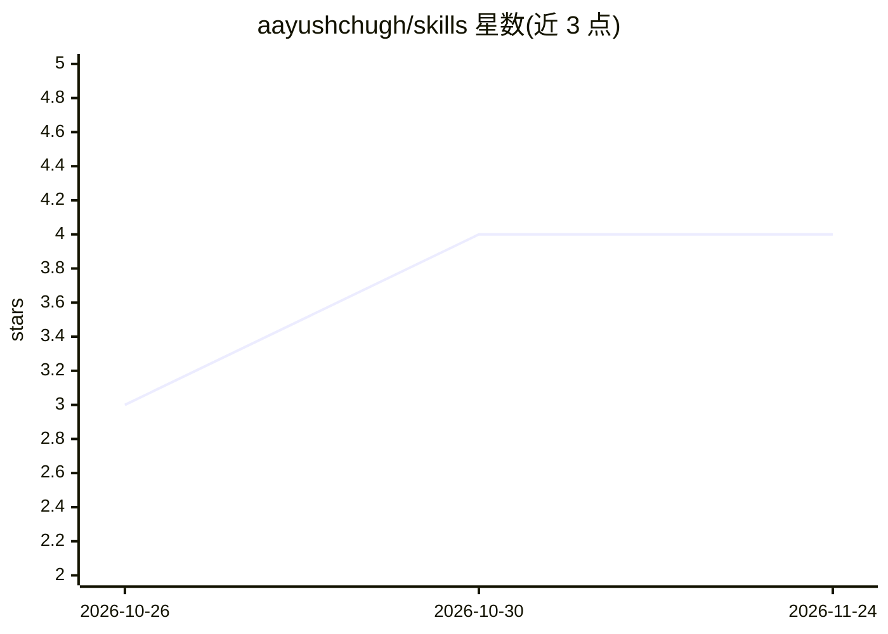

# aayushchugh/skills

⭐ 4 · TypeScript · MIT · 推送 2026-10-28 · [GitHub](https://github.com/aayushchugh/skills) · [官网](https://skills.ayushchugh.com) · 个人维护

**面向开发者的 agent 技能集合：代码、审查与工程决策技能包**

作者在构建实际产品中使用的 agent 技能集合，以 npm 包 @aayushchugh/skills 发布，配套站点 skills.ayushchugh.com。收录 no-slop（最小可读代码）、plain-paper（撰写规格文档）、red-pen（审查 diff/PR）、the-cause（定位 bug 根因）、go-or-stop（发布决策）、which-skill（选择并运行技能链）等技能，作者声明持续随实践优化。安装方式：作为项目依赖整体 npm 安装后经 Vercel skills CLI 的 experimental_sync 命令同步进 agent，或用 npx skills add 从 GitHub 安装单个技能。

## 筛选速览

| 维度 | 判定 | 备注 |
|---|---|---|
| AI 角色 | `ai-knowledge` | 知识聚合/清单类 |
| 许可风险 | `permissive` | MIT |
| 部署形态 | `library` | 以包/库形式分发 |
| 模型依赖 | — | README 未给出锁定关系 |
| 硬件要求 | — | 无带数字的原话,不猜 |
| 安装摩擦 | `low` | 无编译、无系统依赖或容器化 |
| 成熟度 | — | 结构信号不足 |

## 能力要点

- 以 npm 包形式分发，经 Vercel skills CLI 的 experimental_sync 命令同步进 agent
- 支持 npx skills add 从 GitHub 安装单个技能
- 技能覆盖代码编写、安全审计、架构审查、根因分析、发布决策等环节
- 作者声明随实践持续优化技能内容

## 适用场景

- 给 agent 配置代码编写与重构的约束技能
- 让 agent 审查 PR、依赖与部署配置中的安全问题
- 让 agent 依据代码路径定位 bug 根因

## 场景标签

`编码 Agent` `代码审查` `提示工程` · 领域:Agent 开发

## 证据(README 行号)

> L3: These are the agent skills I use while building real products. I keep optimizing them as better practices show up.
> L28: ## Skills
> L30: - `no-slop` — No slop. Write the smallest readable code that reuses existing code, installed utilities, and repo pa

## 星数曲线

2026-10-26 3 → 2026-11-24 4（+1）

---
*卡片 v1 · prompt 1.4 · 生成 2026-11-21 · 置信度 high · 依据 README sha `15b216e5d02e` · [字段定义](../../DATASET.md)*
