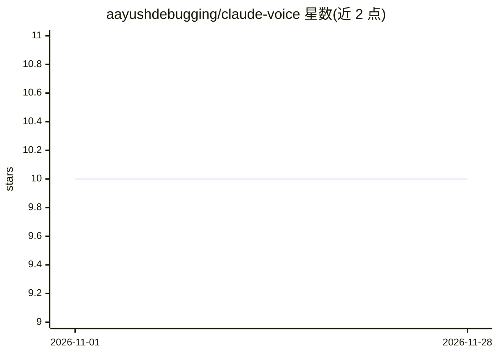

# aayushdebugging/claude-voice

⭐ 10 · TypeScript · MIT · 推送 2026-07-11 · [GitHub](https://github.com/aayushdebugging/claude-voice) · [官网](https://aayushdebugging.github.io/claude-voice/) · 个人维护

**为 Claude CLI 加语音层的终端工具：开口说话即可对话**

基于 Node.js/TypeScript 的 CLI 工具，在 Claude CLI 之上叠加实时语音交互：麦克风语音经 STT 转写后送入 claude，回复边生成边按句合成播放，支持 barge-in 随时打断、无间隙流式播放（依赖 ffmpeg/ffplay）。默认走 Groq Whisper 与 ElevenLabs 云服务；也可用 claude-voice local 配置 whisper.cpp + Kokoro 的纯本地免费栈。复用已有 claude 安装与会话，无需 API key；serve 命令可从手机浏览器远程对话，远程会话默认禁用 Claude 工具。

## 筛选速览

| 维度 | 判定 | 备注 |
|---|---|---|
| AI 角色 | `ai-enhanced` | 去掉 AI 部分产品仍成立 |
| 许可风险 | `permissive` | MIT |
| 部署形态 | `library` | 以包/库形式分发 |
| 模型依赖 | locked-api |  |
| 硬件要求 | — | 无带数字的原话,不猜 |
| 安装摩擦 | `medium` | 含编译或系统依赖之一 |
| 成熟度 | — | 结构信号不足 |

## 能力要点

- STT→Claude→TTS 流水线，回复按句流式合成、边生成边播放
- barge-in 打断：插话即停播放与生成并转入监听
- claude-voice local 配置 whisper.cpp + Kokoro 纯本地 $0 栈
- serve 命令生成 QR 链接，同一 Wi-Fi 下用手机语音对话

## 适用场景

- 在终端用语音与 Claude 结对编程
- 不方便打字时口头向 Claude 下达指令并听回答
- 局域网内用手机免提与 Claude 交互

## 场景标签

`语音 Agent` `编码 Agent` · 领域:编码与开发

## 证据(README 行号)

> L14: `claude-voice` is a **native voice layer on top of the Claude CLI**, not a
> L24: - 🧠 **Wraps the Claude CLI** — uses your existing `claude` install and session; **no Claude API key required**.
> L131: Run entirely offline with open-source models — no cloud, no keys, $0:

## 星数曲线

2026-11-01 10 → 2026-11-28 10（+0）

---
*卡片 v1 · prompt 1.4 · 生成 2026-11-20 · 置信度 high · 依据 README sha `1383a97b25f3` · [字段定义](../../DATASET.md)*
