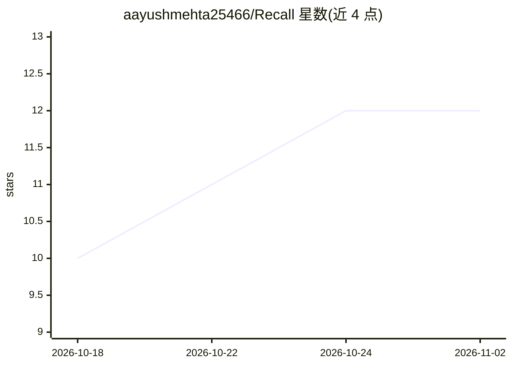

# aayushmehta25466/Recall

⭐ 12 · JavaScript · Apache-2.0 · 推送 2026-10-25 · [GitHub](https://github.com/aayushmehta25466/Recall) · 个人维护

**本地优先的浏览器书签自动整理扩展，AI 可选**

运行于 Chrome/Firefox/Opera 的 Manifest V3 书签管理扩展，无服务器、无账号，数据留在浏览器内。保存书签时先由本地规则（域名映射+关键词评分）即时分类归档，未匹配项可在用户开启后批量发送至 OpenRouter 做 AI 分类；另提供 BM25 全文搜索（模糊容错）、URL 规范化去重、软删除回收站、JSON/CSV/HTML 导入导出与自定义规则。不配置 AI 功能也可完整使用。

## 筛选速览

| 维度 | 判定 | 备注 |
|---|---|---|
| AI 角色 | `ai-enhanced` | 去掉 AI 部分产品仍成立 |
| 许可风险 | `permissive` | Apache-2.0 |
| 部署形态 | `library` | 以包/库形式分发 |
| 模型依赖 | locked-api |  |
| 硬件要求 | — | 无带数字的原话,不猜 |
| 安装摩擦 | `low` | 无编译、无系统依赖或容器化 |
| 成熟度 | — | 结构信号不足 |

## 能力要点

- 两阶段分类：本地规则即时归档，AI 仅批量处理未匹配项且需用户开启
- BM25 全文搜索，20% 模糊容错与 Ctrl/⌘+K 快捷呼出
- URL 规范化去重与可配置自动清理的回收站
- 无服务器、无账号，数据存于本地浏览器

## 适用场景

- 自动把积累的书签分类到固定目录结构
- 在大量书签中快速全文搜索并容忍拼写错误
- 清理重复保存的书签并批量整理

## 场景标签

 · 领域:浏览器/效率工具

## 证据(README 行号)

> L12:  A smart, local-first bookmark organizer. Rules-first auto-sorting, optional AI,
> L96: Recall is fully usable with zero AI — the rules engine handles most domains locally. An OpenRouter key only matters

## 星数曲线

2026-10-18 10 → 2026-11-02 12（+2）

---
*卡片 v1 · prompt 1.4 · 生成 2026-11-01 · 置信度 high · 依据 README sha `2e6a7e3dc578` · [字段定义](../../DATASET.md)*
