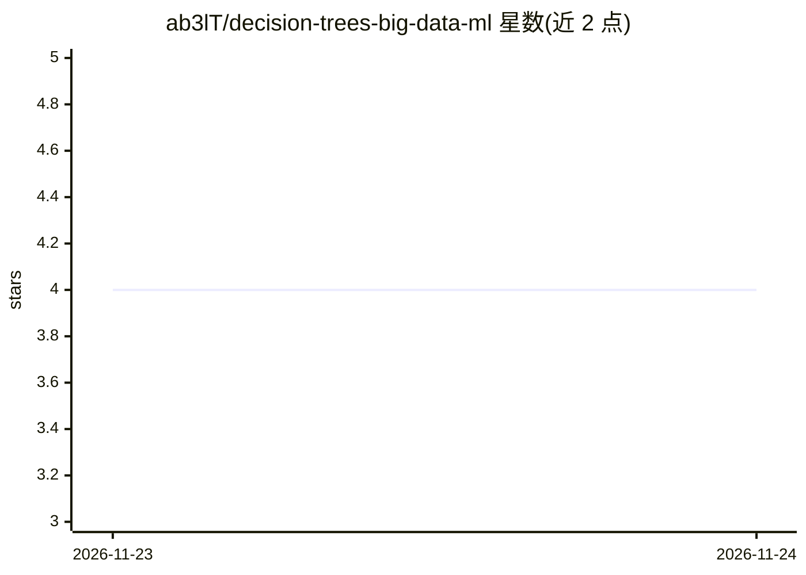

# ab3lT/decision-trees-big-data-ml

⭐ 4 · Jupyter Notebook · 推送 2026-10-31 · [GitHub](https://github.com/ab3lT/decision-trees-big-data-ml) · 个人维护

**决策树课程教学笔记本：讲概念数学并配可运行的 scikit-learn 代码**

Big Data and Machine Learning 课程的决策树教学仓库，提供两个已全部执行的 Jupyter 笔记本：分类（银行营销数据预测订阅）与回归（汽车价格预测 MSRP）。内容覆盖 CART 概念、Gini/熵/MSE 公式、数据清洗与特征工程、scikit-learn Pipeline、评估指标手算验证、树可视化、过拟合分析与 GridSearchCV 调参，每本末尾附学生练习。可通过 Google Colab 免安装打开，或本地建虚拟环境运行。

## 筛选速览

| 维度 | 判定 | 备注 |
|---|---|---|
| AI 角色 | `ai-knowledge` | 知识聚合/清单类 |
| 许可风险 | `none` | — |
| 部署形态 | `None` |  |
| 模型依赖 | — | README 未给出锁定关系 |
| 硬件要求 | — | 无带数字的原话,不猜 |
| 安装摩擦 | `low` | 无编译、无系统依赖或容器化 |
| 成熟度 | — | 结构信号不足 |

## 能力要点

- 2 个已完整执行的笔记本，可在 GitHub 直接阅读输出与图表
- Gini/熵/分裂增益/评估指标的公式推导并在代码中验证
- 覆盖 EDA、清洗、Pipeline、过拟合、GridSearchCV 调参全流程
- 每本末尾附练习题，配合 fork 工作流完成

## 适用场景

- 跟学决策树的分类与回归实战
- 用真实数据集练习特征工程与调参
- 在 fork 中完成课程练习并提交

## 场景标签

`教程课程` · 领域:学习与行业

## 证据(README 行号)

> L3: > **Course:** Big Data and Machine Learning
> L6: > Hands-on, fully-executed Jupyter notebooks that teach **Decision Trees** for **classification** and **regression**

## 星数曲线

2026-11-23 4 → 2026-11-24 4（+0）

---
*卡片 v1 · prompt 1.4 · 生成 2026-11-23 · 置信度 high · 依据 README sha `7406e64854f7` · [字段定义](../../DATASET.md)*
