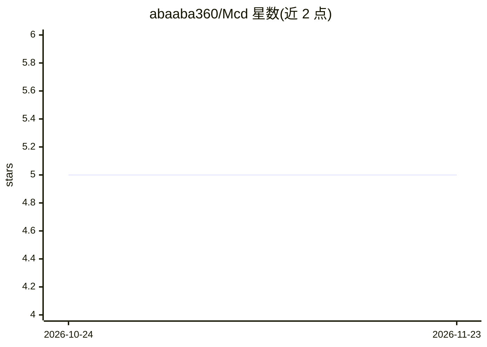

# abaaba360/Mcd

⭐ 5 · Python · MIT · 推送 2026-10-23 · [GitHub](https://github.com/abaaba360/Mcd) · 个人维护 · 中文 README

**帮团队点单人 30 秒完成满足多人约束的麦当劳点单**

基于麦当劳官方 MCP 构建的 Agent Skill，面向「被派去买全组午饭的人」：通过 SKILL.md 描述六步流程，调用 MCP 的菜单查询、算价、营养接口，对多人忌口、预算、热量约束做求解，并对比买卡与不买卡两种成本、给出券替换建议，最后渲染可发群里的投喂清单卡片。附 Python 参考实现（约束求解零依赖）与 35 个工具的实测契约文档。流程只读、付款由人完成；券后价需手工填写，团餐与多轮改单未完成。

## 筛选速览

| 维度 | 判定 | 备注 |
|---|---|---|
| AI 角色 | `ai-native` | 本体是模型或模型工具 |
| 许可风险 | `permissive` | MIT |
| 部署形态 | `library` | 以包/库形式分发 |
| 模型依赖 | — | README 未给出锁定关系 |
| 硬件要求 | — | 无带数字的原话,不猜 |
| 安装摩擦 | `low` | 无编译、无系统依赖或容器化 |
| 成熟度 | — | 结构信号不足 |

## 能力要点

- 基于麦当劳官方 MCP，提供 35 个工具的实测契约文档
- 多人忌口×预算×热量约束求解与买卡/不买卡双账对比
- 渲染层不生成数字，图片价格全部来自 calculate-price 实测返回
- 菜单快照离线可跑，约束求解零依赖

## 适用场景

- 为 3 人以上、口味预算互相冲突的团队一次性点好午饭
- 行政统一采购下午茶/加班餐并凑满减
- 减脂小组按热量约束点餐
- 情侣/室友凑单并分配一张券的最优用法

## 场景标签

`AI 助手` · 领域:对话与助手

## 证据(README 行号)

> L3: > 帮「被派去买全组午饭的那个人」，在 30 秒内完成一次不会有人不满意的点单。
> L11: 麦当劳 1024 程序员创意开发大赛参赛作品。基于麦当劳官方 MCP 构建的 Agent Skill。

## 星数曲线

2026-10-24 5 → 2026-11-23 5（+0）

---
*卡片 v1 · prompt 1.4 · 生成 2026-11-21 · 置信度 mid · 依据 README sha `d0901e356112` · [字段定义](../../DATASET.md)*
