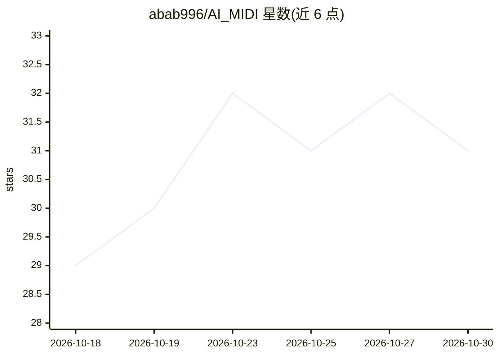

# abab996/AI_MIDI

⭐ 31 · JavaScript · Apache-2.0 · 推送 2026-10-16 · [GitHub](https://github.com/abab996/AI_MIDI) · [官网](https://aimidi.baimoo.top/) · 个人维护 · 中文 README

**本地优先的 AI 辅助音乐创作与 MIDI 编曲桌面应用**

基于 Wails/Go 的桌面应用，通过单个 OpenAI 兼容 API（默认 DeepSeek）让 AI 参与音乐创作：多轮对话中 AI 直接读写 MIDI 文件（配和弦、译配歌词、设计花腔、生成旋律），操作可撤销；提供 FL Studio 风格编曲视图（音轨、钢帘、SF2 音源、全局 BPM、WAV 导出，早期 beta）与 Windows 专用 JUCE 低延迟音频引擎。项目数据与 API key 全部留在本地。v3.0 从网页版改为独立桌面应用，无需 Python。

## 筛选速览

| 维度 | 判定 | 备注 |
|---|---|---|
| AI 角色 | `ai-native` | 本体是模型或模型工具 |
| 许可风险 | `permissive` | Apache-2.0 |
| 部署形态 | `desktop` | 安装包/桌面程序 |
| 模型依赖 | locked-api |  |
| 硬件要求 | — | 无带数字的原话,不猜 |
| 安装摩擦 | `low` | 无编译、无系统依赖或容器化 |
| 成熟度 | `idea` | |

## 能力要点

- 多轮对话中 AI 直接操作 MIDI 文件，步骤可见且可撤销
- Quick Tasks 一键式处理：配和弦、歌词译配（支持日文假名）、花腔设计
- FL Studio 风格编曲视图与 SF2 音源、WAV 导出（早期 beta）
- 本地优先：项目数据与 API key 仅存本地 settings.json

## 适用场景

- 给已有旋律自动配和弦并导出 MIDI
- 让 AI 按乐理逐步生成旋律、花腔等素材
- 在时间线视图中编排 AI 生成的 MIDI 片段并导出 WAV

## 场景标签

 · 领域:音乐创作/桌面工具

## 证据(README 行号)

> L5: **AI_MIDI** is a local-first desktop app that lets AI assist your music creation: add chords to a melody, translate 
> L13: - **The AI operates MIDI directly**: say *"Write an 8-bar C major melody with a syncopated rhythm"* and it reads th

## 星数曲线

2026-10-18 29 → 2026-10-30 31（+2）

---
*卡片 v1 · prompt 1.4 · 生成 2026-10-26 · 置信度 mid · 依据 README sha `2614e37d7da5` · [字段定义](../../DATASET.md)*
