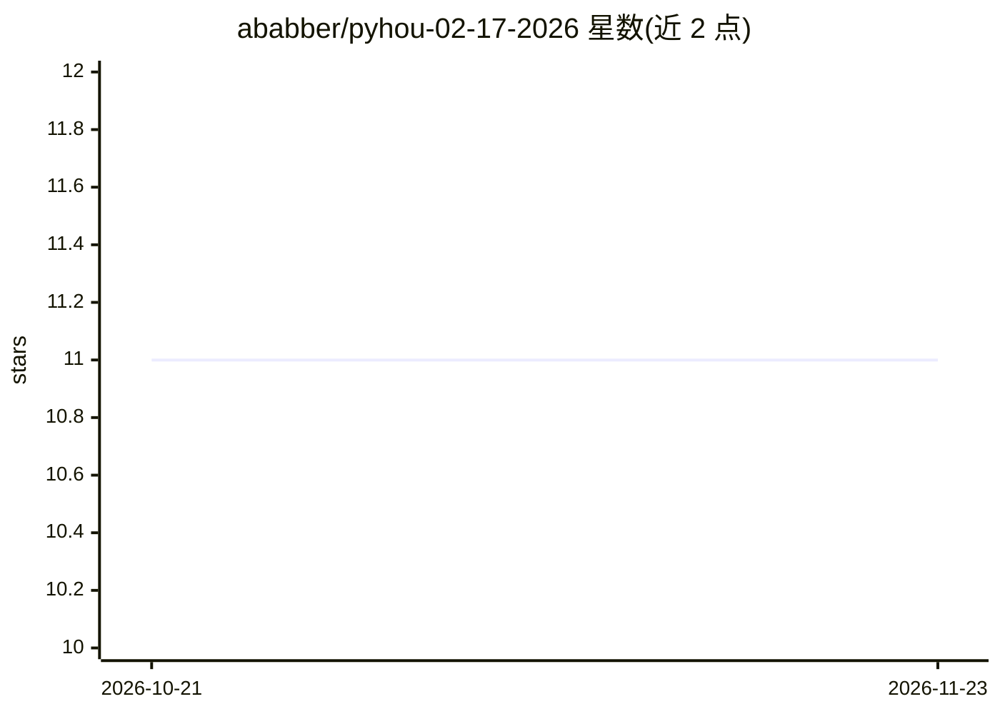

# ababber/pyhou-02-17-2026

⭐ 11 · HTML · MIT · 推送 2026-03-19 · [GitHub](https://github.com/ababber/pyhou-02-17-2026) · [官网](https://www.youtube.com/playlist?list=PLBfBLYe88LVVhpUMeBLzqXWWw90vT6_A6) · 个人维护

**量化交易教学视频系列配套 notebook：三类 ML 在 QuantConnect 回测**

配套 2026 年 2 月 PyHou Meetup 的三段 YouTube 教学视频的代码仓库，包含三部分内容：Ridge 回归做波动率预测的逆波动率配置、时序卷积网络做股价涨跌三分类、Amazon Chronos 基础模型做零样本价格轨迹预测。实际回测策略运行在 QuantConnect 云平台上，notebook 本身用于讲解与叙事，可在 Colab 打开运行。README 声明内容仅供教育用途，非投资建议，且展示的策略跑输买入持有基准。

## 筛选速览

| 维度 | 判定 | 备注 |
|---|---|---|
| AI 角色 | `ai-knowledge` | 知识聚合/清单类 |
| 许可风险 | `permissive` | MIT |
| 部署形态 | `library` | 以包/库形式分发 |
| 模型依赖 | — | README 未给出锁定关系 |
| 硬件要求 | — | 无带数字的原话,不猜 |
| 安装摩擦 | `low` | 无编译、无系统依赖或容器化 |
| 成熟度 | — | 结构信号不足 |

## 能力要点

- 三部分内容分别使用 Ridge 回归、时序 CNN、Amazon Chronos 基础模型
- 策略在 QuantConnect 云平台回测，notebook 含完整算法源码
- 提供 YouTube 视频与 Colab 入口，Part 3 端到端流水线需 T4 GPU
- 包含 PSR 显著性、tokenization 前视偏差等局限性的取证式分析

## 适用场景

- 学习在 QuantConnect 上实现和回测 ML 交易策略
- 对比经典机器学习、深度学习与基础模型在金融时序上的做法
- 在教学环境中复现量化交易 meetup 演示

## 场景标签

`金融量化` · 领域:学习与行业

## 证据(README 行号)

> L3: *Can machine learning predict financial markets? This repo accompanies a 3-part video series where I test three gene
> L79: ## Local Setup
> L123: This material is based on a live presentation I gave at PyHou (Houston Python Meetup) on February 17, 2026.

## 星数曲线

2026-10-21 11 → 2026-11-23 11（+0）

---
*卡片 v1 · prompt 1.4 · 生成 2026-11-18 · 置信度 mid · 依据 README sha `3c29b293edb5` · [字段定义](../../DATASET.md)*
