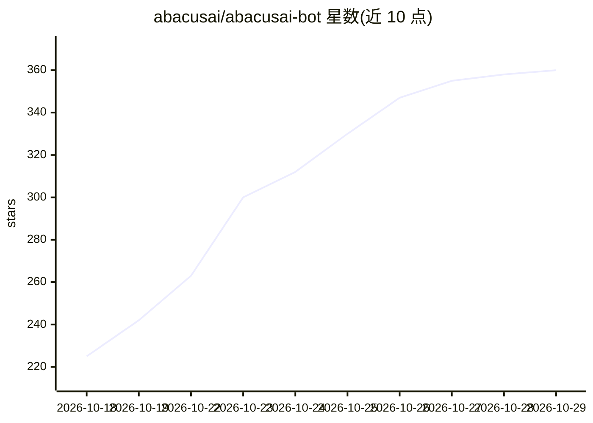

# abacusai/abacusai-bot

⭐ 360 · TypeScript · MIT · 推送 2026-10-28 · [GitHub](https://github.com/abacusai/abacusai-bot) · [官网](https://bot.abacus.ai) · 组织维护

**免费开源的桌面个人 AI agent 应用，接入聊天与办公工具**

MIT 许可的桌面应用（macOS/Windows/Linux 安装包）：用户创建具名 bot，为其配置指令与模型，bot 各自保有聊天与记忆，可从 WhatsApp、Telegram、Discord 或桌面端对话，并通过 100+ 连接器（Gmail、Google Drive、Slack、GitHub、Notion 等）与 MCP 服务器执行任务、定时例程、编码与创作。默认模式为 Full access，无沙箱与审批提示；带 Abacus.AI API key 时会向 Abacus.AI 上传转录与日志。模型可经 Abacus.AI 免费额度、OpenRouter/Groq 等密钥或本地 OpenAI 兼容端点接入，RouteLLM 在免费模型间切换。

## 筛选速览

| 维度 | 判定 | 备注 |
|---|---|---|
| AI 角色 | `ai-native` | 本体是模型或模型工具 |
| 许可风险 | `permissive` | MIT |
| 部署形态 | `library` | 以包/库形式分发 |
| 模型依赖 | locked-api |  |
| 硬件要求 | — | 无带数字的原话,不猜 |
| 安装摩擦 | `low` | 无编译、无系统依赖或容器化 |
| 成熟度 | — | 结构信号不足 |

## 能力要点

- 创建具名 bot，各有模型、记忆与聊天，支持 WhatsApp/Telegram/Discord 远程对话
- 100+ 连接器与 MCP 服务器、本地工具、浏览器与设备接入
- 例程可按小时/天/周/webhook 定时运行并记录输出
- RouteLLM 在免费模型不可用时自动切换，支持本地 OpenAI 兼容模型

## 适用场景

- 我在 WhatsApp/Telegram 上让个人 agent 帮我处理邮件、日程和跟进事项
- 我让 bot 定时生成每日简报或研究简报
- 半夜让 bot 修代码、跑测试并开 PR

## 场景标签

`编码 Agent` `AI 助手` · 领域:编码与开发

## 证据(README 行号)

> L21: Create a bot for a job you want to hand off. Give it a name, instructions, and a model. Each bot keeps its own chat
> L23: Coding is one of the jobs a bot can do. AbacusAI Bot is built for personal assistance, research, communication, rec
> L30: The desktop app is free and MIT-licensed. You do not need an existing paid model subscription. A free Abacus.AI acc

## 星数曲线

2026-10-18 225 → 2026-10-29 360（+135）

---
*卡片 v1 · prompt 1.4 · 生成 2026-10-22 · 置信度 mid · 依据 README sha `0f2002a6395b` · [字段定义](../../DATASET.md)*
