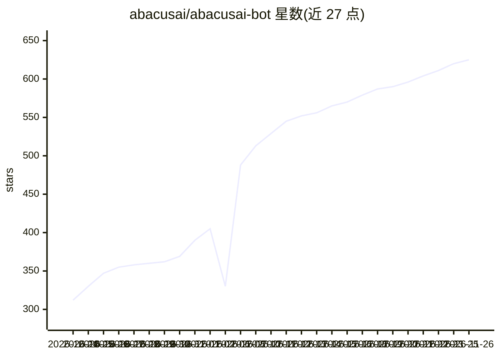

# abacusai/abacusai-bot

⭐ 625 · TypeScript · MIT · 推送 2026-11-25 · [GitHub](https://github.com/abacusai/abacusai-bot) · [官网](https://bot.abacus.ai) · 组织维护

**开源免费桌面应用，为消息与工作工具创建个人 AI agent**

MIT 许可的桌面应用（macOS/Windows/Linux 安装包），用于创建常驻个人 agent（bot）：每个 bot 有自己的指令、模型、聊天记录与记忆，可从桌面端或 WhatsApp/Telegram/Discord 收发消息，并在 Gmail、Slack、GitHub、Notion 等连接服务中执行任务，支持按计划或 webhook 例程运行。免费账户含 2,000 积分与免费模型，可用 OpenRouter、Groq 等 key 补充；RouteLLM-Open 在免费模型间自动路由，也支持付费 key 或本地 OpenAI 兼容模型。默认 Full access 无审批模式，Auto 模式提供内核沙箱。仓库仅含桌面应用，不发布 CLI/SDK。

## 筛选速览

| 维度 | 判定 | 备注 |
|---|---|---|
| AI 角色 | `ai-native` | 本体是模型或模型工具 |
| 许可风险 | `permissive` | MIT |
| 部署形态 | `library` | 以包/库形式分发 |
| 模型依赖 | — | README 未给出锁定关系 |
| 硬件要求 | — | 无带数字的原话,不猜 |
| 安装摩擦 | `low` | 无编译、无系统依赖或容器化 |
| 成熟度 | — | 结构信号不足 |

## 能力要点

- bot 具备独立 mission、persona、模型、文件夹与记忆，支持定时例程与 webhook 触发
- 通过 WhatsApp/Telegram/Discord 远程消息交互，含发送者与远程工具审批控制
- 100+ 连接器，支持 MCP server、skills、本地工具、浏览器与文件
- Auto 模式在 macOS、Linux（bubblewrap）、Windows 11 24H2+ 提供内核沙箱

## 适用场景

- 凌晨让 bot 修改代码、跑测试并开 pull request
- 通过 WhatsApp/Telegram 随时与个人 agent 对话交办任务
- 用连接器让 bot 读写邮件、日历、文件并更新 issue
- 设置早报、跟进追踪等每小时/每日定时例程

## 场景标签

`AI 助手` `编码 Agent` · 领域:编码与开发

## 证据(README 行号)

> L1: AbacusAI Bot: 100% free, open source. Your own personal agents for your messaging apps, tools and services.
> L21: Create a bot for a job you want to hand off. Give it a name, instructions, and a model. Each bot keeps its own chat
> L30: The desktop app is free and MIT-licensed. You do not need an existing paid model subscription. A free Abacus.AI acc

## 星数曲线

2026-10-24 312 → 2026-11-26 625（+313）

---
*卡片 v1 · prompt 1.4 · 生成 2026-11-25 · 置信度 high · 依据 README sha `884ab3fcc7f9` · [字段定义](../../DATASET.md)*
