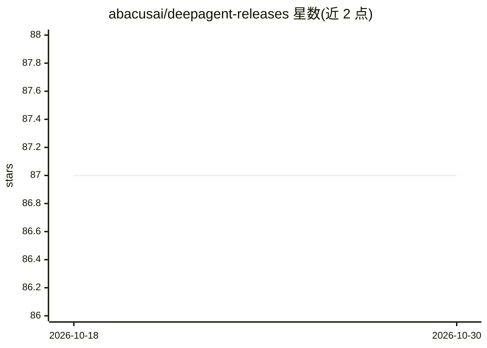

# abacusai/deepagent-releases

⭐ 87 · 推送 2026-10-27 · [GitHub](https://github.com/abacusai/deepagent-releases) · [官网](https://desktop.abacus.ai) · 组织维护

**桌面 AI 助手：集成浏览、语音、编码 CLI 与编辑器**

Abacus AI 发布的桌面 AI 助手产品页，描述其具备 agentic 浏览、听写（listening）、编码 CLI 与编辑器能力，定位为一站式 AI 平台。README 提供三种交付形态：桌面应用、VSCode 扩展和 CLI。页面未给出安装命令、依赖说明或使用细节，仅含 Get Started 引导徽章。信息以产品介绍为主，具体功能文档需进入 Get Started 入口查看。

## 筛选速览

| 维度 | 判定 | 备注 |
|---|---|---|
| AI 角色 | `ai-native` | 本体是模型或模型工具 |
| 许可风险 | `none` | — |
| 部署形态 | `None` |  |
| 模型依赖 | — | README 未给出锁定关系 |
| 硬件要求 | — | 无带数字的原话,不猜 |
| 安装摩擦 | `low` | 无编译、无系统依赖或容器化 |
| 成熟度 | — | 结构信号不足 |

## 能力要点

- 桌面 AI 助手，含 agentic 浏览与听写能力
- 提供桌面应用、VSCode 扩展与 CLI 三种形态
- 内置编码 CLI 与编辑器

## 适用场景

- 在桌面端通过 AI 助手自动化日常工作
- 在编辑器与 CLI 中使用 AI 编码功能

## 场景标签

`AI 助手` · 领域:对话与助手

## 证据(README 行号)

> L7: A powerful desktop AI assistant with agentic browsing, listening, coding CLI and editor.
> L14: VSCode Extension
> L16: CLI

## 星数曲线

2026-10-18 87 → 2026-10-30 87（+0）

---
*卡片 v1 · prompt 1.4 · 生成 2026-10-23 · 置信度 low · 依据 README sha `3d67dfd09f5c` · [字段定义](../../DATASET.md)*
