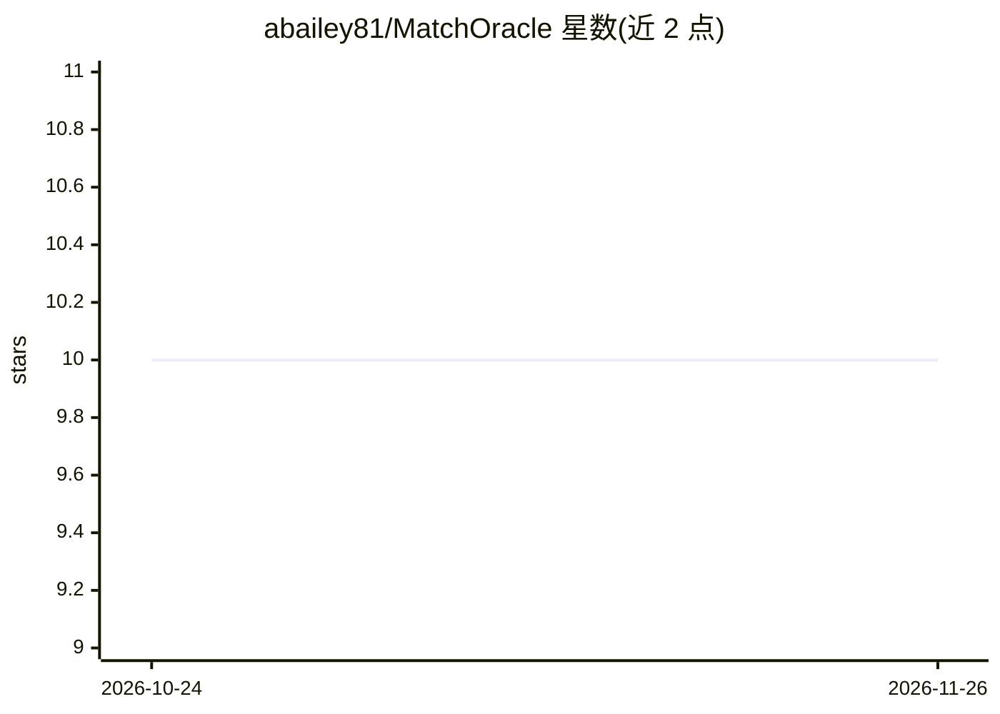

# abailey81/MatchOracle

⭐ 10 · Python · MIT · 推送 2026-03-15 · [GitHub](https://github.com/abailey81/MatchOracle) · 个人维护

**基于 13 个基学习器集成模型的英超比赛结果预测引擎**

以 8 个数据源约 20 个赛季（约 7,600 场）真实比赛数据为输入的英超赛果预测系统：Layer 0 采用 Dixon-Coles 统计模型，Layer 1 为 13 个基学习器（含 XGBoost、LightGBM、CatBoost、MLP），其上叠加元学习器、二分类提升与最优集成选择共 5 层堆叠结构；特征工程覆盖 Elo/Glicko-2/Pi-Ratings、滚动状态、市场赔率与 30 个实时新闻情感特征（RoBERTa 转换器加关键词回退）；提供 walk-forward 回测指标、置信度分层输出、交互式 CLI 与自动生成的 HTML 仪表板；模型缓存支持训练后 2 秒内出预测。

## 筛选速览

| 维度 | 判定 | 备注 |
|---|---|---|
| AI 角色 | `ai-native` | 本体是模型或模型工具 |
| 许可风险 | `permissive` | MIT |
| 部署形态 | `None` |  |
| 模型依赖 | — | README 未给出锁定关系 |
| 硬件要求 | — | 无带数字的原话,不猜 |
| 安装摩擦 | `low` | 无编译、无系统依赖或容器化 |
| 成熟度 | — | 结构信号不足 |

## 能力要点

- 5 层堆叠集成：Dixon-Coles 统计模型 + 13 基学习器 + 元学习器
- 376+ 工程特征，覆盖评分体系、市场情报与上下文因素
- RoBERTa 新闻情感分析，30 个实时情感特征注入预测
- 交互式 CLI 与 Plotly/Chart.js HTML 仪表板

## 适用场景

- 预测英超比赛的主胜/平/客胜结果
- 研究体育比赛预测的特征工程与集成方法
- 查看按置信度分层的回测与预测结果

## 场景标签

 · 领域:体育数据/机器学习应用

## 证据(README 行号)

> L16: **An advanced EPL match prediction system** built on real data from 8 sources spanning 20 seasons (~7,600 matches).
> L31: - Layer 1: 13 base learners (HGB, XGB, LightGBM, CatBoost, RF, MLP)

## 星数曲线

2026-10-24 10 → 2026-11-26 10（+0）

---
*卡片 v1 · prompt 1.4 · 生成 2026-11-20 · 置信度 high · 依据 README sha `eaba058764a5` · [字段定义](../../DATASET.md)*
