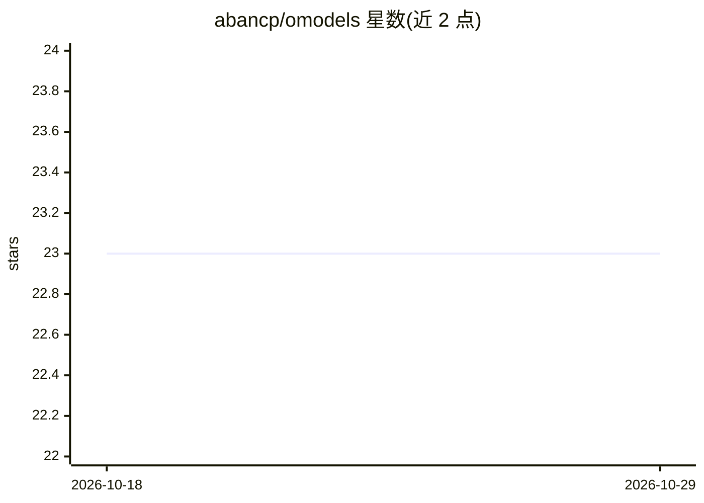

# abancp/omodels

⭐ 23 · TypeScript · MIT · 推送 2026-09-10 · [GitHub](https://github.com/abancp/omodels) · [官网](https://models.radr.in) · 个人维护

**浏览器内机器学习学习与建模平台，无需安装与代码**

基于 React 与 TensorFlow.js（WebGL 后端）的纯浏览器 AI/ML 平台：提供实时交互 16+ 种经典 ML 算法与深度学习架构的 Playground（含损失曲线、决策边界、代码生成）、节点式 DAG Pipeline Builder、以及可导入/清洗表格、图像、文本、时序数据的 Data Studio。全部在本地浏览器运行，无账号、无云端依赖。支持将数据集、模型与管线导出为可移植的 .om JSON 文件。

## 筛选速览

| 维度 | 判定 | 备注 |
|---|---|---|
| AI 角色 | `ai-native` | 本体是模型或模型工具 |
| 许可风险 | `permissive` | MIT |
| 部署形态 | `library` | 以包/库形式分发 |
| 模型依赖 | — | README 未给出锁定关系 |
| 硬件要求 | — | 无带数字的原话,不猜 |
| 安装摩擦 | `low` | 无编译、无系统依赖或容器化 |
| 成熟度 | — | 结构信号不足 |

## 能力要点

- 实时交互 16+ 种经典 ML 算法与深度学习架构，显示损失曲线与决策边界
- 节点式可视化 DAG 编辑器构建预处理-模型-集成管线
- 数据工作室支持表格/图像/文本/时序数据的导入、可视化与清洗
- 工作区（数据集+模型+管线）导出为单一可移植 .om JSON 文件

## 适用场景

- 在浏览器中直观学习经典 ML 算法与深度学习的原理
- 不写代码搭建并训练机器学习管线
- 清洗和可视化自己的表格、图像或时序数据

## 场景标签

`教程课程` · 领域:学习与行业

## 证据(README 行号)

> L8: Omodels is a serious, interactive machine learning environment where learning, experimenting, and building are the s
> L14: * 🎮 **Playground:** Interact with 16+ classical ML algorithms and deep learning architectures in real-time. See liv

## 星数曲线

2026-10-18 23 → 2026-10-29 23（+0）

---
*卡片 v1 · prompt 1.4 · 生成 2026-10-27 · 置信度 mid · 依据 README sha `f8ab3fc48dd4` · [字段定义](../../DATASET.md)*
