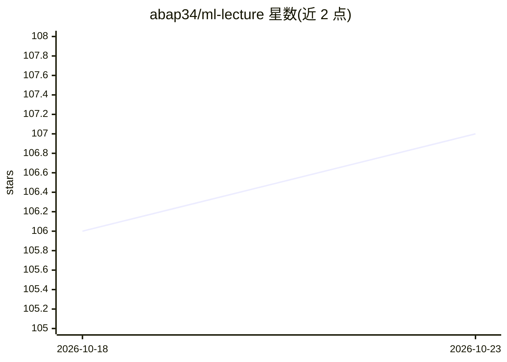

# abap34/ml-lecture

⭐ 107 · HTML · MIT · 推送 2026-09-13 · [GitHub](https://github.com/abap34/ml-lecture) · [官网](https://abap34.github.io/ml-lecture/) · 组织维护

**面向本科新生的机器学习讲习会教材（日文，PyTorch）**

东京工业大学数字创作同好会 traP Kaggle 班 2024 年「机器学习讲习会」的教材仓库，面向首次接触机器学习的本科一年级成员，目标是从基本机器学习概念理解到能用神经网络解决实际问题。资料以 GitHub Pages 公开网页形式发布，配套在线判题系统（ml-lecture-judge）与数据分析竞赛平台（DacQ-v2），部分链接仅限社团成员访问。内容涉及 PyTorch 与深度学习。

## 筛选速览

| 维度 | 判定 | 备注 |
|---|---|---|
| AI 角色 | `ai-knowledge` | 知识聚合/清单类 |
| 许可风险 | `permissive` | MIT |
| 部署形态 | `None` |  |
| 模型依赖 | — | README 未给出锁定关系 |
| 硬件要求 | — | 无带数字的原话,不猜 |
| 安装摩擦 | `low` | 无编译、无系统依赖或容器化 |
| 成熟度 | — | 结构信号不足 |

## 能力要点

- 教材以 GitHub Pages 公开网页发布
- 目标从基础概念到神经网络实际应用
- 配套在线判题系统与数据分析竞赛平台（需自行部署）
- 日文编写，含 PyTorch 主题标签

## 适用场景

- 初学者系统学习机器学习与神经网络基础
- 高校社团组织机器学习讲习会
- 寻找日文的 PyTorch 入门教材

## 场景标签

`教程课程` · 领域:学习与行业

## 证据(README 行号)

> L4: このレポジトリは、 東京工業大学デジタル創作同好会 traP Kaggle班 が2024年に実施した
> L9: 1. 基本的な機械学習のアイデアを理解して、
> L14: 資料は GitHub Pages で公開しています。

## 星数曲线

2026-10-18 106 → 2026-10-23 107（+1）

---
*卡片 v1 · prompt 1.4 · 生成 2026-10-23 · 置信度 high · 依据 README sha `f15f04807043` · [字段定义](../../DATASET.md)*
