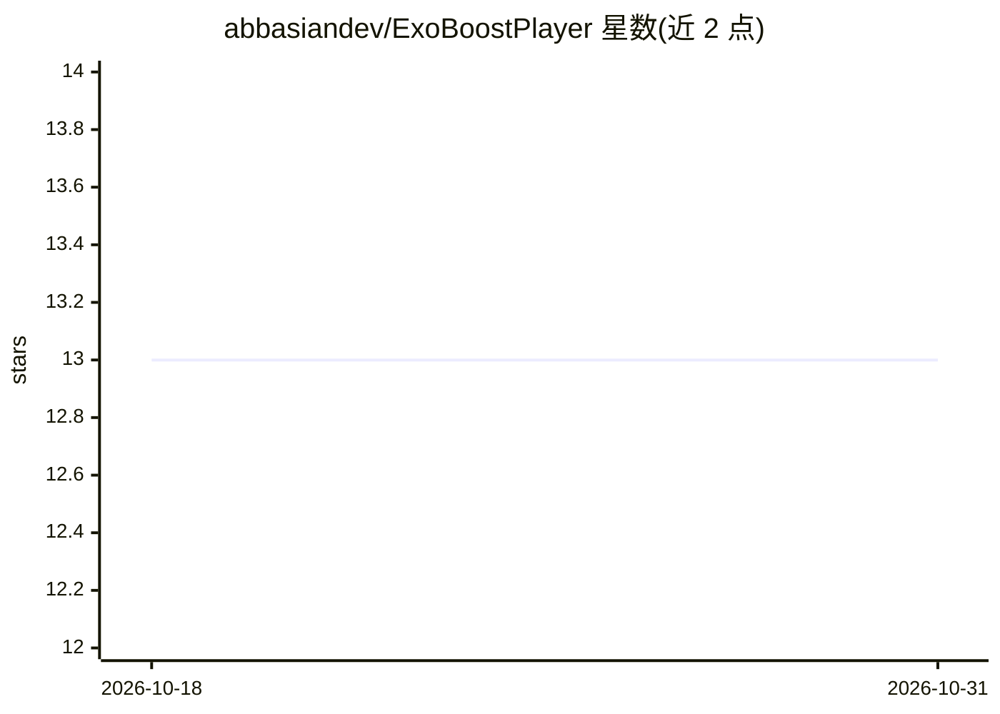

# abbasiandev/ExoBoostPlayer

⭐ 13 · Kotlin · Apache-2.0 · 推送 2026-02-09 · [GitHub](https://github.com/abbasiandev/ExoBoostPlayer) · [官网](https://medium.com/stackademic/the-rise-of-exoboost-building-an-intelligent-media-player-that-never-gives-up-cb25e6c5295b) · 个人维护

**Android 开发者的增强 ExoPlayer 封装库，含 AI 视频分析**

面向 Android 开发者的 ExoPlayer 封装库：提供 Jetpack Compose 即用组件（视频/音频播放器）、智能错误恢复（指数退避重试、硬解到软解码码器回退、自动降码率）、自适应画质切换、均衡器与音频可视化、手势控制、字幕支持（VTT/SRT 搜索/下载/自动加载）。AI 视频分析部分含场景检测（直方图分析）、运动跟踪、音频 RMS 分析、人脸检测、自动高光片段与章节生成，支持多线程并行处理与快 速模式。通过 Maven Central 以 Gradle 依赖安装，需在 Application 类初始化。

## 筛选速览

| 维度 | 判定 | 备注 |
|---|---|---|
| AI 角色 | `ai-enhanced` | 去掉 AI 部分产品仍成立 |
| 许可风险 | `permissive` | Apache-2.0 |
| 部署形态 | `None` |  |
| 模型依赖 | — | README 未给出锁定关系 |
| 硬件要求 | — | 无带数字的原话,不猜 |
| 安装摩擦 | `low` | 无编译、无系统依赖或容器化 |
| 成熟度 | — | 结构信号不足 |

## 能力要点

- 场景检测、运动跟踪、人脸检测与自动高光/章节生成
- 错误自动恢复：重试退避、硬软解码器回退、自动降码率
- Jetpack Compose 即用视频/音频播放器组件，含均衡器与可视化
- 多线程并行分析与低配设备快速模式

## 适用场景

- 在 Android 应用中快速集成带错误恢复的视频播放器
- 为视频内容自动生成高光片段和章节
- 构建带均衡器和可视化的音频播放界面

## 场景标签

 · 领域:移动开发/媒体播放

## 证据(README 行号)

> L3: Enhanced ExoPlayer wrapper with intelligent error handling, automatic recovery, adaptive quality switching, and AI-p
> L25: - **Ready-to-use Compose Components**: Drop-in video and audio players

## 星数曲线

2026-10-18 13 → 2026-10-31 13（+0）

---
*卡片 v1 · prompt 1.4 · 生成 2026-10-31 · 置信度 high · 依据 README sha `0c7f10cd5fe1` · [字段定义](../../DATASET.md)*
