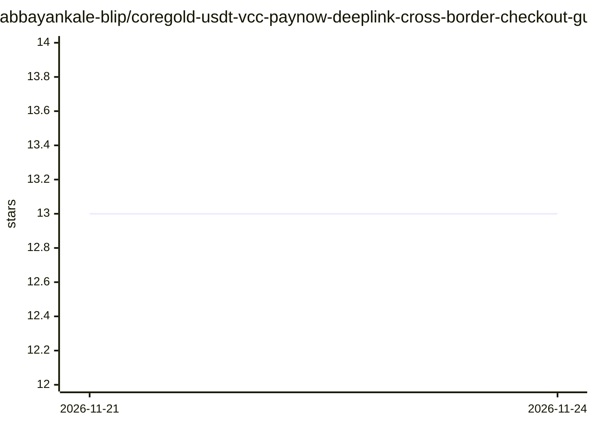

# abbayankale-blip/coregold-usdt-vcc-paynow-deeplink-cross-border-checkout-guide

⭐ 36 · 推送 2026-11-19 · [GitHub](https://github.com/abbayankale-blip/coregold-usdt-vcc-paynow-deeplink-cross-border-checkout-guide) · [官网](https://app.coregold.io/signup?invite_code=ADvlj9b) · 个人维护 · 中文 README

**面向跨境付款用户的 CoreGold USDT 虚拟卡开卡与绑卡教程**

以蚂蚁国际推进 PayNow 深链接为背景撰写的跨境支付流程指南：对比网页填卡与数字钱包两类结账场景，分步骤讲解 CoreGold 虚拟卡的注册、USDT（TRC20）充值、套餐与卡段选择、账单信息填写，以及绑定 Apple Pay / Google Pay 的操作流程。内容面向需要为海外数字服务与订阅付款的个人用户，文末提供官网注册链接。属于教程/指南类文档，不含可安装运行的代码。

## 筛选速览

| 维度 | 判定 | 备注 |
|---|---|---|
| AI 角色 | `ai-knowledge` | 知识聚合/清单类 |
| 许可风险 | `none` | — |
| 部署形态 | `None` |  |
| 模型依赖 | — | README 未给出锁定关系 |
| 硬件要求 | — | 无带数字的原话,不猜 |
| 安装摩擦 | `low` | 无编译、无系统依赖或容器化 |
| 成熟度 | — | 结构信号不足 |

## 能力要点

- 四步开卡流程：注册、USDT TRC20 充值、选套餐与卡段、填账单信息
- Apple Pay / Google Pay 绑定步骤与邮箱验证方式说明
- 对比网页填卡与数字钱包两类结账场景的适用性

## 适用场景

- 我想订阅海外 AI 工具但没有合适的美区卡
- 我想用 USDT 充值开一张虚拟卡
- 我想把虚拟卡绑定到 Apple Pay 或 Google Pay

## 场景标签

`教程课程` · 领域:学习与行业

## 证据(README 行号)

> L2: 结合蚂蚁国际推进 PayNow 深链接跨境电商与数字支付体验升级的热点，对比跨境支付中不同支付方式的使用场景，并给出 CoreGold USDT 虚拟卡极简开卡与 Apple Pay / Google Pay 绑定指南。
> L20: ### 🧭 傻瓜级开卡与绑卡教程（一看就会）

## 星数曲线

2026-11-21 13 → 2026-11-24 13（+0）

---
*卡片 v1 · prompt 1.4 · 生成 2026-11-21 · 置信度 high · 依据 README sha `50e072b71e18` · [字段定义](../../DATASET.md)*
