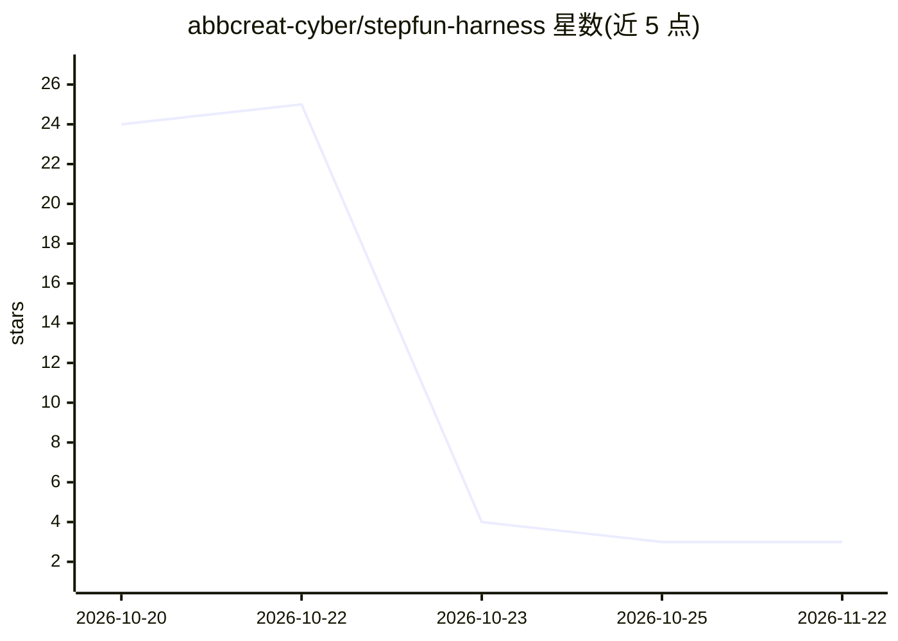

# abbcreat-cyber/stepfun-harness

⭐ 3 · TypeScript · Apache-2.0 · 推送 2026-10-19 · [GitHub](https://github.com/abbcreat-cyber/stepfun-harness) · 个人维护 · 中文 README

**连接阶跃订阅与 API 的桌面 AI 工作台，让 AI 执行任务**

社区开发的桌面 AI 工作台，将 Step Code 底座接入 Electron 桌面界面，把模型、文件、终端、浏览器、插件与工作流放进同一工作空间。支持 Step Plan 订阅与 API 双通道接入，自定义供应商兼容 OpenAI/Anthropic 协议；提供可视化多代理工作流、文档插件（Word/PDF/表格）、Mini 任务悬浮条与会话统计。提供 Windows x64 安装包与源码运行方式，安装包自带运行依赖，模型账号与额度由用户自备。主工程开源，随附插件与文档技能含独立许可与部分非商业限制。

## 筛选速览

| 维度 | 判定 | 备注 |
|---|---|---|
| AI 角色 | `ai-native` | 本体是模型或模型工具 |
| 许可风险 | `permissive` | Apache-2.0 |
| 部署形态 | `desktop` | 安装包/桌面程序 |
| 模型依赖 | — | README 未给出锁定关系 |
| 硬件要求 | — | 无带数字的原话,不猜 |
| 安装摩擦 | `low` | 无编译、无系统依赖或容器化 |
| 成熟度 | — | 结构信号不足 |

## 能力要点

- 订阅与 API、自定义供应商在同一模型选择器中接入
- 可视化多代理工作流：阶段、并行子任务、产物面板
- 内置文档插件与轻量 Office 引擎，经 @插件 激活
- 安装包自带 Step 底座与运行库，无需另装 Node.js/Python

## 适用场景

- 从一句需求让 AI 在本机读取文件、执行命令并产出可交付文件
- 并行调研多代理协作并汇总检查产物
- 在桌面界面统一管理订阅与 API 模型通道

## 场景标签

`多智能体` `AI 助手` · 领域:Agent 开发

## 证据(README 行号)

> L16: 阶跃星辰 Harness 将 Step Code 底座接入完整桌面界面，把模型、文件、终端、浏览器、插件与工作流放进同一个工作空间。使用 Step Plan 订阅，或配置 API 和自定义模型；任务过程、并行代理与最终产物，都能在
> L18: > **社区项目，非阶跃星辰、Z.ai、DeepSeek 或 OpenAI 官方产品。** 提供 Windows x64 安装包与源码。主工程开源；随附第三方插件保留独立许可，四类原版文档技能含非商业限制，详见 LICENSES.

## 星数曲线

2026-10-20 24 → 2026-11-22 3（-21）

---
*卡片 v1 · prompt 1.4 · 生成 2026-11-22 · 置信度 high · 依据 README sha `b80cd0144fda` · [字段定义](../../DATASET.md)*
