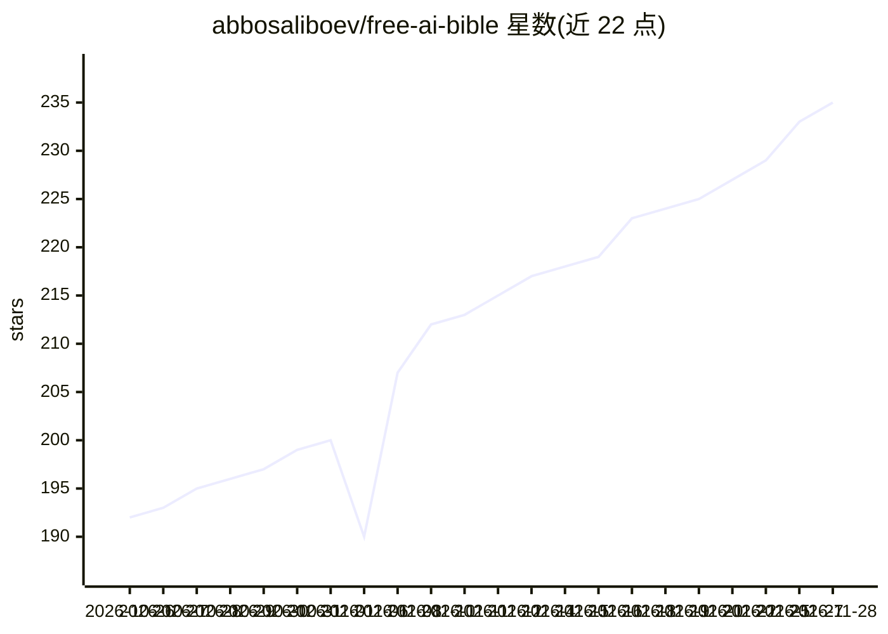

# abbosaliboev/free-ai-bible

⭐ 235 · JavaScript · MIT · 推送 2026-10-22 · [GitHub](https://github.com/abbosaliboev/free-ai-bible) · [官网](https://github.com/abbosaliboev/free-ai-bible) · 个人维护 · 中文 README

**面向开发者的免费 AI API 与本地 AI 工具目录（72 条资源）**

以清单形式聚合免费 LLM API、图像生成、本地模型运行、编程助手、嵌入/RAG、语音、Agent 框架与模型托管等类别的 72 条资源，标注各家免费额度与许可信息；提供可搜索、可过滤、可收藏并支持 CSV/JSON 导出的交互式目录，以及 Groq 聊天机器人、本地 RAG、本地运行 Ollama 等可运行示例模板。声明无联盟链接与付费推广，免费额度随模型、账户与地区变化，需自行核对当前方案。

## 筛选速览

| 维度 | 判定 | 备注 |
|---|---|---|
| AI 角色 | `ai-knowledge` | 知识聚合/清单类 |
| 许可风险 | `permissive` | MIT |
| 部署形态 | `library` | 以包/库形式分发 |
| 模型依赖 | — | README 未给出锁定关系 |
| 硬件要求 | — | 无带数字的原话,不猜 |
| 安装摩擦 | `low` | 无编译、无系统依赖或容器化 |
| 成熟度 | — | 结构信号不足 |

## 能力要点

- 按 9 个类别组织 72 条资源，标注免费额度与许可
- 可搜索、过滤、收藏的交互式目录，支持 CSV/JSON 下载
- 提供 Groq 聊天、本地 RAG、图像 API、语音助手等启动模板
- 含阿拉伯语指南与多语言版本

## 适用场景

- 为副项目寻找不用信用卡的免费 LLM API
- 挑选本地运行模型的工具组合
- 对比向量数据库与 RAG 组件的自托管方案

## 场景标签

`精选清单` · 领域:学习与行业

## 证据(README 行号)

> L10: # 🧠 Free AI Bible 2026
> L63: ### 🔥 Free LLM APIs
> L59: **☁️ Free tier** = hosted service with usage limits. **🖥️ Local** = run it yourself using your own hardware. Full l

## 星数曲线

2026-10-26 192 → 2026-11-28 235（+43）

---
*卡片 v1 · prompt 1.4 · 生成 2026-11-25 · 置信度 mid · 依据 README sha `0a9389246765` · [字段定义](../../DATASET.md)*
