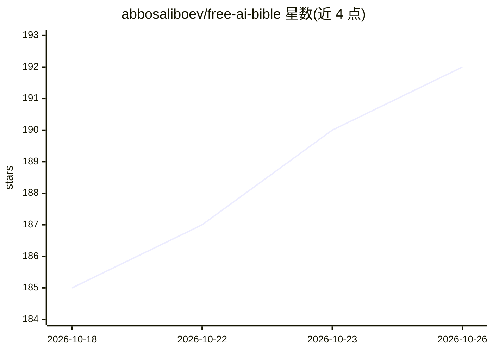

# abbosaliboev/free-ai-bible

⭐ 192 · JavaScript · MIT · 推送 2026-10-22 · [GitHub](https://github.com/abbosaliboev/free-ai-bible) · [官网](https://github.com/abbosaliboev/free-ai-bible) · 个人维护 · 中文 README

**免费 AI API 与工具策展清单：700+ 资源按类别整理**

面向开发者的免费 AI 资源聚合清单（awesome list）：收录 700+ 条经作者测试验证的免费资源，以表格形式按免费 LLM API（Groq/Google AI Studio/Mistral 等）、图像视频生成、模型托管平台、本地 AI 工具、向量数据库、语音转写等类别组织，标注免费额度与限制；另提供快速上手示例（云端 LLM、本地 Ollama 栈、本地图像生成）、/scripts 一键脚本与 /templates 应用模板，社区通过 PR 贡献并要求核实资源真实免费。

## 筛选速览

| 维度 | 判定 | 备注 |
|---|---|---|
| AI 角色 | `ai-knowledge` | 知识聚合/清单类 |
| 许可风险 | `permissive` | MIT |
| 部署形态 | `library` | 以包/库形式分发 |
| 模型依赖 | — | README 未给出锁定关系 |
| 硬件要求 | — | 无带数字的原话,不猜 |
| 安装摩擦 | `low` | 无编译、无系统依赖或容器化 |
| 成熟度 | — | 结构信号不足 |

## 能力要点

- 700+ 免费资源按 6+ 类别表格化组织，标注免费额度与限制
- 提供云端/本地/图像生成三条 5 分钟内可跑通的快速上手路径
- 附 /scripts 一键安装脚本与 /templates 应用模板
- 社区 PR 贡献机制，要求提交前核实资源真实免费

## 适用场景

- 我要找不用信用卡的免费 LLM API 来开发应用
- 我要零预算搭建本地 LLM/图像生成/转写工具栈
- 我要对比各托管平台免费层能部署什么

## 场景标签

`精选清单` · 领域:学习与行业

## 证据(README 行号)

> L10: # 🧠 Free AI Bible 2026 — Free AI APIs & Tools for Developers
> L18: **700+ free AI tools, APIs, and services — curated, tested, and organized.**
> L29: This repository proves that a skilled developer can build production-grade AI applications — LLMs, image generation

## 星数曲线

2026-10-18 185 → 2026-10-26 192（+7）

---
*卡片 v1 · prompt 1.4 · 生成 2026-10-22 · 置信度 mid · 依据 README sha `0c085b265157` · [字段定义](../../DATASET.md)*
