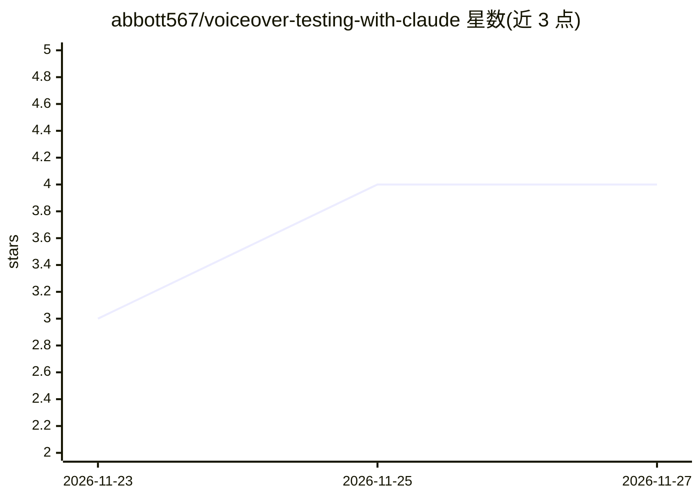

# abbott567/voiceover-testing-with-claude

⭐ 4 · HTML · MIT · 推送 2026-10-19 · [GitHub](https://github.com/abbott567/voiceover-testing-with-claude) · [官网](https://www.craigabbott.co.uk/blog/2026/automated-screen-reader-testing-with-claude-code-voiceover-and-gherkin/) · 个人维护

**用 Claude Code 驱动 macOS VoiceOver 自动执行屏幕阅读器无障碍测试**

一篇博客文章的配套仓库：以 Gherkin 场景描述屏幕阅读器用户应听到的内容，Claude Code 读取场景文件，通过封装 VoiceOver AppleScript 字典的 vo.sh 脚本开启 VoiceOver、移动光标并逐条捕获朗读内容，与 Then 步骤比对后生成报告。包含登录示例应用、权限配置步骤（AppleScript 控制、辅助功能授权）、smoke-test.sh 自检脚本，以及可跨项目使用的 Claude Code skill 打包版本。仅支持 macOS 与 VoiceOver。

## 筛选速览

| 维度 | 判定 | 备注 |
|---|---|---|
| AI 角色 | `ai-enhanced` | 去掉 AI 部分产品仍成立 |
| 许可风险 | `permissive` | MIT |
| 部署形态 | `None` |  |
| 模型依赖 | locked-api |  |
| 硬件要求 | — | 无带数字的原话,不猜 |
| 安装摩擦 | `low` | 无编译、无系统依赖或容器化 |
| 成熟度 | — | 结构信号不足 |

## 能力要点

- Claude Code 读取 Gherkin 场景并驱动 VoiceOver 执行与捕获朗读
- vo.sh 封装 VoiceOver AppleScript 字典，提供 find/activate/last 子命令
- 附带依赖零的登录示例应用与可复现的失败示例
- 可打包为 Claude Code skill 跨项目复用

## 适用场景

- 自动化检测网页的标签缺失、标题结构、焦点处理等无障碍问题
- 为登录表单等页面编写 Gherkin 屏幕阅读器验收场景
- 在多个项目中以 skill 形式复用 VoiceOver 测试能力

## 场景标签

`编码 Agent` `GUI 自动化` · 领域:效率与自动化

## 证据(README 行号)

> L5: VoiceOver on macOS has an AppleScript dictionary, so a script can turn it on, move its cursor and read back the last
> L19: |`skill/voiceover-testing/`|The same instructions and wrapper packaged as a Claude Code skill, for use across proje

## 星数曲线

2026-11-23 3 → 2026-11-27 4（+1）

---
*卡片 v1 · prompt 1.4 · 生成 2026-11-23 · 置信度 high · 依据 README sha `0c156c2aad33` · [字段定义](../../DATASET.md)*
