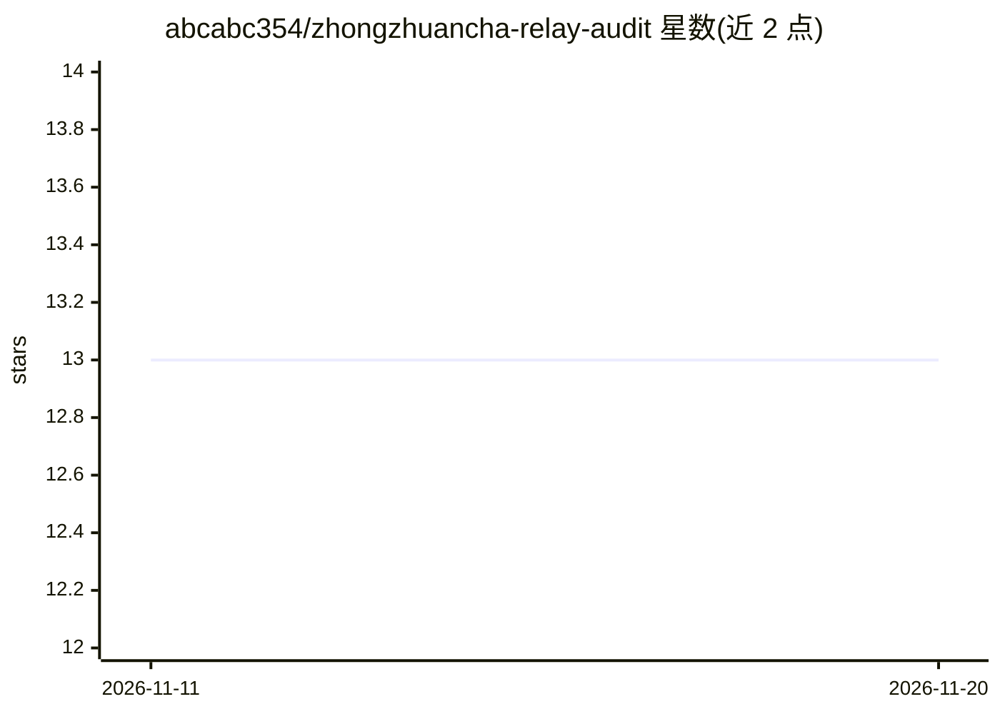

# abcabc354/zhongzhuancha-relay-audit

⭐ 13 · Python · MIT · 推送 2026-11-13 · [GitHub](https://github.com/abcabc354/zhongzhuancha-relay-audit) · [官网](https://zhongzhuancha.com/) · 个人维护 · 中文 README

**给 AI 中转站做可用性与协议面审计的 Python CLI 工具**

中转查（zhongzhuancha.com）的 audit-only 工具仓库：对 OpenAI 兼容中转站执行体检，回答 /responses 或 Chat 接口是否可用、流式/工具/结构化/视觉是否正常、协议参数与错误码是否像官方等。评分机制上主分只看稳定性、对话、能力、目录四项，协议契约与错误码放在附录作为证据不扣主分；先探测 /responses，不支持则自动回退 Chat-only。仓库不含 API key 与真实报告，不认证底层型号身份。

## 筛选速览

| 维度 | 判定 | 备注 |
|---|---|---|
| AI 角色 | `ai-ecosystem` | LLM/agent 周边工具 |
| 许可风险 | `permissive` | MIT |
| 部署形态 | `library` | 以包/库形式分发 |
| 模型依赖 | — | README 未给出锁定关系 |
| 硬件要求 | — | 无带数字的原话,不猜 |
| 安装摩擦 | `low` | 无编译、无系统依赖或容器化 |
| 成熟度 | `idea` | |

## 能力要点

- 探测 /responses 并自动回退 Chat-only 的审计流程
- 主分与协议附录分离的评分口径（协议面只作证据不扣主分）
- PyPI 安装 + 源码安装两种途径，保留旧版 relay-audit/compare/trend/inspect 兼容命令

## 适用场景

- 在充值使用某个 AI 中转站前先检查其接口是否可用
- 检查中转站的流式、工具调用、结构化输出、视觉是否正常工作
- 对比中转站协议面（参数、错误码）与官方 API 的一致性

## 场景标签

`模型评测` · 领域:评测与运维

## 证据(README 行号)

> L7:  给 OpenAI 兼容中转做一次“能不能用、协议面是否像官方”的体检。
> L29: 这个仓库是它的 **clean audit-only** 工具：只回答“能不能用、协议面是否像官方”，不认证型号身份。
> L42: |Responses / Chat 面是否可用|底层权重是不是某个具体型号|

## 星数曲线

2026-11-11 13 → 2026-11-20 13（+0）

---
*卡片 v1 · prompt 1.4 · 生成 2026-11-18 · 置信度 high · 依据 README sha `a64740f16f8b` · [字段定义](../../DATASET.md)*
