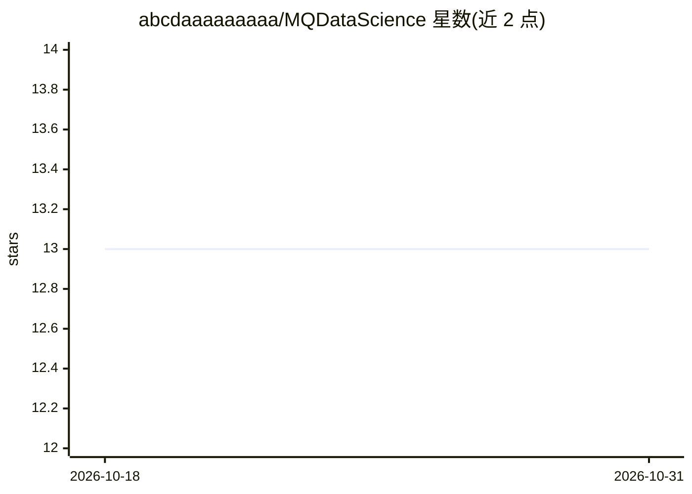

# abcdaaaaaaaaa/MQDataScience

⭐ 13 · Python · MIT · 推送 2026-10-02 · [GitHub](https://github.com/abcdaaaaaaaaa/MQDataScience) · [官网](https://project.uzay.info/MQDataScience) · 个人维护

**Arduino MQ 气体传感器数据分析库：曲线回归与 ppm 计算**

面向 Arduino 开发者的 MQ 系列气体传感器（MQ-2 至 MQ-309A 共 21 型）数据处理库：按 y=axᵇ 公式拟合传感器曲线并计算 ppm，提供温湿度修正系数模型（插值计算 a/b/c 常数）、3D ppm 曲面图与 4D 时变曲线预测；对 R²≥0.9995 的曲线统一采用对数法合并公式。含 76 种算法（经典回归、卡尔曼滤波、集成学习、神经网络等）对温度/湿度/空气质量数据做交叉验证并自动选取 R² 最高的模型。另附 STEL 限值表、预热时间、电路图、电压范围与 RL 负载电阻建议。

## 筛选速览

| 维度 | 判定 | 备注 |
|---|---|---|
| AI 角色 | `ai-native` | 本体是模型或模型工具 |
| 许可风险 | `permissive` | MIT |
| 部署形态 | `None` |  |
| 模型依赖 | — | README 未给出锁定关系 |
| 硬件要求 | — | 无带数字的原话,不猜 |
| 安装摩擦 | `low` | 无编译、无系统依赖或容器化 |
| 成熟度 | — | 结构信号不足 |

## 能力要点

- 覆盖 21 型 MQ 气体传感器的曲线拟合与 ppm 计算公式
- 温湿度修正系数模型（RH 33-85 区间插值 + 指数温度项）
- 76 种算法交叉验证并自动选择 R² 最高模型做预测
- 提供 3D ppm 曲面图与时间维度 4D 曲线预测

## 适用场景

- 读取 MQ 传感器阻值比并换算为气体 ppm 浓度
- 按温湿度条件修正传感器读数
- 用多种回归/机器学习模型预测空气质量趋势

## 场景标签

 · 领域:嵌入式传感器/数据科学

## 证据(README 行号)

> L127: From classical regression methods, multivariable regression models, curve fitting and spline-based approaches, tim
> L18: ## 5) Curve Prediction in Time-Dependent 4D Space

## 星数曲线

2026-10-18 13 → 2026-10-31 13（+0）

---
*卡片 v1 · prompt 1.4 · 生成 2026-10-31 · 置信度 high · 依据 README sha `96432111cde1` · [字段定义](../../DATASET.md)*
