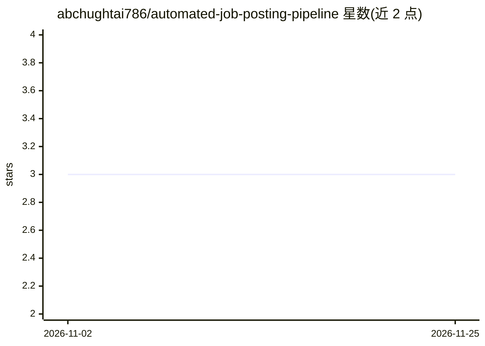

# abchughtai786/automated-job-posting-pipeline

⭐ 3 · JavaScript · MIT · 推送 2026-11-01 · [GitHub](https://github.com/abchughtai786/automated-job-posting-pipeline) · 个人维护

**给求职者聚合职位并经 AI 筛选后发布的 Node.js 流水线**

Node.js 流水线，从公司招聘页与职位板 RSS 采集入门级职位和实习，用规则加 AI 筛除骗局、高级岗位和不完整条目，去重后排序，生成 SEO 友好的职位页面并模拟发布到 WordPress、提交搜索引擎索引。AI 检查失败时职位转人工审核而非直接发布；每条处理完即保存进度以支持重启续跑。当前为 demo 版本，仅跑样例数据，不真实发布；含 47 个自动化测试，由 GitHub Actions 在每次更新时运行。

## 筛选速览

| 维度 | 判定 | 备注 |
|---|---|---|
| AI 角色 | `ai-enhanced` | 去掉 AI 部分产品仍成立 |
| 许可风险 | `permissive` | MIT |
| 部署形态 | `None` |  |
| 模型依赖 | locked-api |  |
| 硬件要求 | — | 无带数字的原话,不猜 |
| 安装摩擦 | `low` | 无编译、无系统依赖或容器化 |
| 成熟度 | `idea` | |

## 能力要点

- 规则+AI 双重筛选骗局（收费、索要银行信息等）与不合格职位
- 改写或跨站点重发的重复职位可被识别跳过
- AI 检查异常时职位转人工审核，未检查内容不发布
- 每条职位处理后保存进度，重启不重复工作

## 适用场景

- 自动聚合入门级职位与实习并过滤诈骗信息
- 搭建职位发布站点的内容生产流水线
- 参考其防提示注入与崩溃恢复的流水线设计

## 场景标签

`工作流自动化` `网页抓取` · 领域:效率与自动化

## 证据(README 行号)

> L8: A Node.js project that automatically finds entry-level jobs and internships, filters out bad or fake listings, and p
> L25: 3. **Screen**: removes senior roles, scams and incomplete posts using rules and AI.
> L42: Node.js · AI integration (Groq) · WordPress REST API and Google Indexing API (opt-in adapters) · Node test runner

## 星数曲线

2026-11-02 3 → 2026-11-25 3（+0）

---
*卡片 v1 · prompt 1.4 · 生成 2026-11-22 · 置信度 high · 依据 README sha `0ab96ccf0b3c` · [字段定义](../../DATASET.md)*
