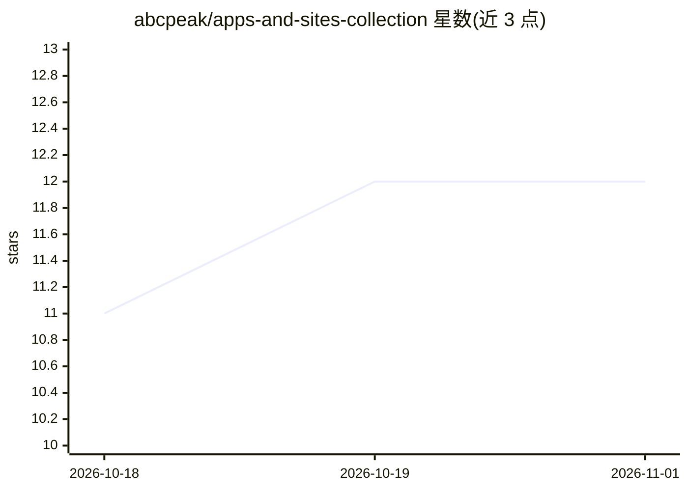

# abcpeak/apps-and-sites-collection

⭐ 12 · JavaScript · MIT · 推送 2026-10-29 · [GitHub](https://github.com/abcpeak/apps-and-sites-collection) · [官网](https://github.com/abcpeak/apps-and-sites-collection) · 个人维护 · 中文 README

**应用与网站推荐合集：跨平台软件、网站、工具的策展清单**

一个 GitHub 上的资源收集仓库，按类别收录应用与网站条目，覆盖图书/PDF 工具、商务、开发者工具（IDE、终端、数据库、爬虫）、网站建设与托管、域名注册、CSS 框架、论坛框架、静态站点生成器、评论系统等。条目标注平台支持（Windows/macOS/Linux/iOS/Android/Web）、是否开源（GitHub Repo stars 标记）与语言描述，面向普通用户与开发者作导航用途；仓库本身为清单内容，无安装运行方式。

## 筛选速览

| 维度 | 判定 | 备注 |
|---|---|---|
| AI 角色 | `ai-knowledge` | 知识聚合/清单类 |
| 许可风险 | `permissive` | MIT |
| 部署形态 | `library` | 以包/库形式分发 |
| 模型依赖 | — | README 未给出锁定关系 |
| 硬件要求 | — | 无带数字的原话,不猜 |
| 安装摩擦 | `high` | 编译与系统依赖俱全 |
| 成熟度 | — | 结构信号不足 |

## 能力要点

- 按图书、开发工具、网站建设、域名注册等十余个类别组织条目
- 条目标注跨平台支持与 GitHub 开源仓库 star 状态
- 收录免费/开源软件、免费域名与 SSL 证书等资源

## 适用场景

- 查找各平台（Windows/macOS/Linux/iOS/Android）的软件替代品
- 建站时查找托管平台、SSG 框架、域名注册商等资源
- 寻找免费或开源的 PDF、电子书、开发类工具

## 场景标签

`精选清单` · 领域:学习与行业

## 证据(README 行号)

> L9: Welcome to the **Curated List of Best Awesome Apps & Sites Collection**!
> L17: ## Table of Contents

## 星数曲线

2026-10-18 11 → 2026-11-01 12（+1）

---
*卡片 v1 · prompt 1.4 · 生成 2026-11-01 · 置信度 mid · 依据 README sha `712946587457` · [字段定义](../../DATASET.md)*
