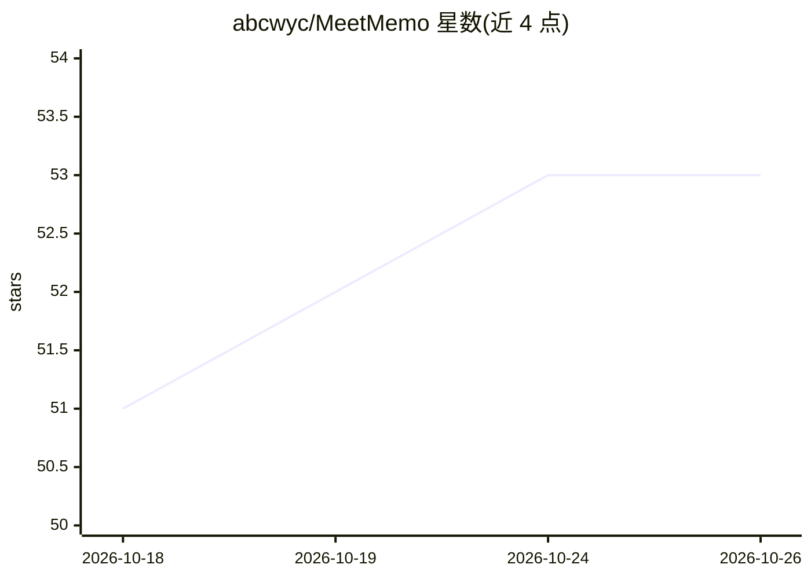

# abcwyc/MeetMemo

⭐ 53 · Swift · NOASSERTION · 推送 2026-10-09 · [GitHub](https://github.com/abcwyc/MeetMemo) · [官网](https://meetmemo.348580.xyz) · 个人维护 · 中文 README

**本地运行的 macOS AI 会议纪要助手：录音转写并生成纪要**

原生 macOS 会议记录应用：同时录制麦克风与系统音频，在本机用 SenseVoice、Fun-ASR-Nano 或 macOS SpeechAnalyzer 三种引擎离线转录（前两种基于 sherpa-onnx，支持说话人识别），再调用用户自行配置的 LLM（Anthropic Messages API 或任意 OpenAI 兼容服务）按内置或自定义模板流式生成结构化纪要，提取行动项写入系统「提醒事项」。另提供系统级全局语音输入与音频文件导入。数据存本机，API Key 存 Keychain；需 macOS 15.5+ 与外部 LLM 服务。采用 PolyForm 非商业许可。

## 筛选速览

| 维度 | 判定 | 备注 |
|---|---|---|
| AI 角色 | `ai-native` | 本体是模型或模型工具 |
| 许可风险 | `none` | NOASSERTION |
| 部署形态 | `desktop` | 安装包/桌面程序 |
| 模型依赖 | locked-api |  |
| 硬件要求 | — | 无带数字的原话,不猜 |
| 安装摩擦 | `medium` | 含编译或系统依赖之一 |
| 成熟度 | — | 结构信号不足 |

## 能力要点

- 麦克风与系统音频双路录制，三种本地离线转录引擎（SenseVoice/Fun-ASR-Nano/SpeechAnalyzer）
- 说话人识别，纪要标注“谁说了什么”
- 会前资料注入与 7 套内置模板，LLM 服务由用户自配（Anthropic 或任意 OpenAI 兼容 API）
- 行动项一键写入系统「提醒事项」，系统级全局语音输入

## 适用场景

- 会议、站会、面试、客户访谈中录音并自动生成纪要
- 导入已有音视频文件转写为会议记录
- 在微信、浏览器等前台应用中用快捷键做语音输入

## 场景标签

`语音识别` `AI 写作` · 领域:内容生成

## 证据(README 行号)

> L11: MeetMemo 是一款原生 macOS AI 会议记录工具。它可以同时捕获麦克风和系统音频，在本机完成实时转录，并结合会前资料、系统提示词和自定义模板，调用你自己配置的大模型生成结构化纪要。
> L17: - **本地语音识别**：内置 SenseVoice、Fun-ASR-Nano 与 macOS SpeechAnalyzer 三种转录引擎，下载模型后无需 STT API Key。
> L44: - **可配置 LLM 服务**：纪要生成支持 Anthropic Messages API，以及任意 OpenAI 兼容的 Chat Completions API（火山方舟、Kimi 等），模型自选。

## 星数曲线

2026-10-18 51 → 2026-10-26 53（+2）

---
*卡片 v1 · prompt 1.4 · 生成 2026-10-24 · 置信度 high · 依据 README sha `ae0795d7c075` · [字段定义](../../DATASET.md)*
