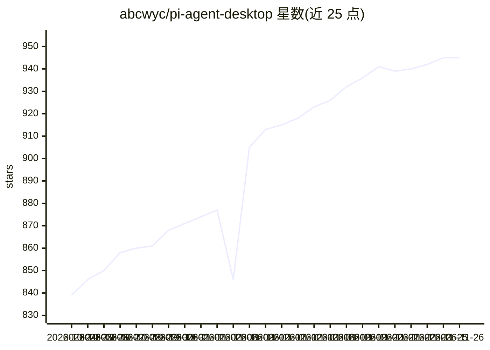

# abcwyc/pi-agent-desktop

⭐ 945 · TypeScript · MIT · 推送 2026-11-23 · [GitHub](https://github.com/abcwyc/pi-agent-desktop) · [官网](https://pi.348580.xyz) · 个人维护 · 中文 README

**把 pi 编码 agent 封装成桌面应用的客户端**

面向 macOS 与 Windows 的本地 AI agent 桌面应用，将 pi 的 agent 能力打包为独立安装程序，无需终端命令或环境配置。提供会话浏览与恢复、分支/分叉对话、模型与 API key 管理、Git worktree 切换、定时任务、文件/代码/PDF 预览及应用内自升级。读取既有 `~/.pi` 本地数据目录，会话与密钥保留在本机；应用未签名的 macOS 构建需手动放行 Gatekeeper。

## 筛选速览

| 维度 | 判定 | 备注 |
|---|---|---|
| AI 角色 | `ai-ecosystem` | LLM/agent 周边工具 |
| 许可风险 | `permissive` | MIT |
| 部署形态 | `desktop` | 安装包/桌面程序 |
| 模型依赖 | — | README 未给出锁定关系 |
| 硬件要求 | — | 无带数字的原话,不猜 |
| 安装摩擦 | `low` | 无编译、无系统依赖或容器化 |
| 成熟度 | — | 结构信号不足 |

## 能力要点

- 按项目浏览并恢复历史 Pi 会话，支持分支与分叉对话
- 内置模型、OAuth/API key、skills 与插件管理
- 定时任务：按 cron/周期在新会话运行保存的 prompt
- 打包 Node.js 运行时与 Pi SDK，无需单独安装 Node.js

## 适用场景

- 不想在终端里操作 pi CLI，用图形界面跑编码 agent
- 跨项目管理和恢复历史 agent 会话
- 让 agent 任务按计划定时自动执行

## 场景标签

`编码 Agent` · 领域:编码与开发

## 证据(README 行号)

> L5: `pi-agent-desktop` is a local AI agent desktop app for macOS and Windows. It packages the agent capabilities of pi i
> L12: - Manage models, OAuth/API keys, custom model configuration, skills, and plugins.

## 星数曲线

2026-10-24 839 → 2026-11-26 945（+106）

---
*卡片 v1 · prompt 1.4 · 生成 2026-11-24 · 置信度 high · 依据 README sha `6f221abbdb1c` · [字段定义](../../DATASET.md)*
