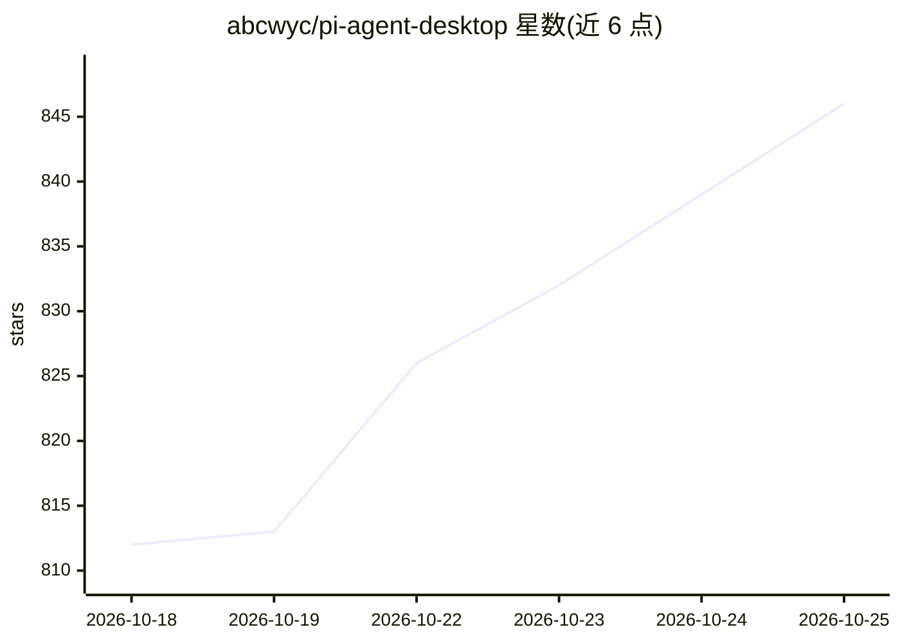

# abcwyc/pi-agent-desktop

⭐ 850 · TypeScript · MIT · 推送 2026-10-25 · [GitHub](https://github.com/abcwyc/pi-agent-desktop) · [官网](https://pi.348580.xyz) · 个人维护 · 中文 README

**把 pi 编程 agent 打包成开箱即用的跨平台桌面应用**

基于 Tauri 的本地 AI 编程 agent 桌面应用（macOS/Windows/Linux），将 pi 的 agent 能力打包为独立安装程序，内嵌 Next.js 服务器、Node.js 运行时与 Pi SDK，无需终端或单独环境。功能含会话浏览与分支/fork、实时查看思考/工具调用/成本/压缩状态、模型与 OAuth/API key 及技能插件管理、定时任务、Git worktree 切换、文件预览、内置更新检查与一键升级。默认读取 ~/.pi/agent/ 本地数据目录，密钥与会话留在本机。

## 筛选速览

| 维度 | 判定 | 备注 |
|---|---|---|
| AI 角色 | `ai-native` | 本体是模型或模型工具 |
| 许可风险 | `permissive` | MIT |
| 部署形态 | `desktop` | 安装包/桌面程序 |
| 模型依赖 | — | README 未给出锁定关系 |
| 硬件要求 | — | 无带数字的原话,不猜 |
| 安装摩擦 | `low` | 无编译、无系统依赖或容器化 |
| 成熟度 | — | 结构信号不足 |

## 能力要点

- 打包 Node.js 运行时与 Pi SDK，安装即用、无需终端命令
- 会话分支/fork 与实时可见的思考、工具调用、成本、压缩状态
- 定时任务（每小时/每日/每周/cron）默认只读工具并在休眠后补跑一次
- 读取 pi CLI 本地数据目录 ~/.pi/agent/，与既有会话和认证互通

## 适用场景

- 不熟悉终端的开发者想在桌面图形界面里使用 pi 编程 agent
- 浏览、恢复、分支管理过往编程会话与项目文件
- 定时自动运行保存的提示词任务并接收成功/失败通知

## 场景标签

`编码 Agent` · 领域:编码与开发

## 证据(README 行号)

> L5: `pi-agent-desktop` is a local AI agent desktop app for macOS and Windows. It packages the agent capabilities of pi i
> L10: - Talk to the agent in real time inside a desktop window, with thinking, tool calls, context usage, cost, and compa
> L47: Official releases support Apple Silicon Macs running macOS 11 or later, Windows 10/11 x64, and Linux x64 distributi

## 星数曲线

2026-10-18 812 → 2026-10-25 846（+34）

---
*卡片 v1 · prompt 1.4 · 生成 2026-10-21 · 置信度 mid · 依据 README sha `b51ab92f22a9` · [字段定义](../../DATASET.md)*
