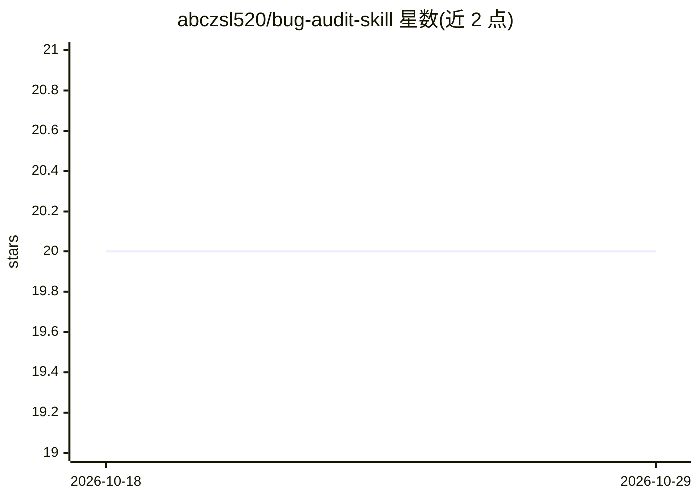

# abczsl520/bug-audit-skill

⭐ 20 · 推送 2026-10-20 · [GitHub](https://github.com/abczsl520/bug-audit-skill) · 个人维护 · 中文 README

**OpenClaw agent 技能：Node.js 项目动态 bug 审计方法论**

面向 OpenClaw（ClawHub）的 agent 技能包，提供 Node.js Web 项目（游戏、数据工具、微信、API、bot）的 bug 审计方法论：先解剖项目构建 6 张项目专属表（API 端点、状态机、定时器、数值、数据流、资源账本），再逐行穷尽校验，辅以 9 个通用审计模块作安全网，最后回归与归档踩坑记录。附 200+ 真实踩坑模式与调试技巧文档，属于 AI Dev Quality Suite 套件之一。通过 clawhub 或 git clone 安装到 ~/.openclaw/skills 使用。

## 筛选速览

| 维度 | 判定 | 备注 |
|---|---|---|
| AI 角色 | `ai-knowledge` | 知识聚合/清单类 |
| 许可风险 | `permissive` | — |
| 部署形态 | `None` |  |
| 模型依赖 | — | README 未给出锁定关系 |
| 硬件要求 | — | 无带数字的原话,不猜 |
| 安装摩擦 | `low` | 无编译、无系统依赖或容器化 |
| 成熟度 | — | 结构信号不足 |

## 能力要点

- 解剖→校验→补充→回归→归档的 5 阶段审计流程
- 6 张项目专属表（含最关键的数据流表，捕捉 API 间逻辑漏洞）
- 200+ 真实踩坑模式与 9 个通用审计模块

## 适用场景

- 让 agent 对 Node.js 项目做穷尽式 bug 排查
- 游戏或 API 项目中捕捉跨接口的逻辑漏洞（如跳过 buy 直接调用 raid-result）
- 归档项目踩坑记录供下次审计复用

## 场景标签

`代码审查` · 领域:编码与开发

## 证据(README 行号)

> L3: ClawHub
> L5: OpenClaw Skill
> L46: clawhub install bug-audit

## 星数曲线

2026-10-18 20 → 2026-10-29 20（+0）

---
*卡片 v1 · prompt 1.4 · 生成 2026-10-28 · 置信度 high · 依据 README sha `1f6f160650fa` · [字段定义](../../DATASET.md)*
