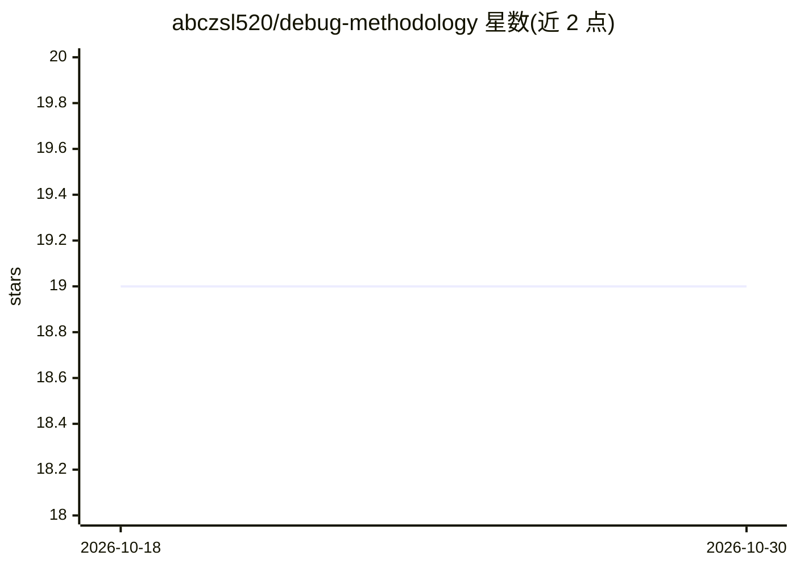

# abczsl520/debug-methodology

⭐ 19 · MIT · 推送 2026-10-20 · [GitHub](https://github.com/abczsl520/debug-methodology) · 个人维护 · 中文 README

**面向 AI Agent 与开发者的系统化调试方法论技能包**

以 SKILL.md 形式提供的调试规范技能：定义 STOP→THINK→TEST→DETECT 四阶段强制调试流程、快速决策树、环境检查清单与部署安全流程，并标注醉汉/路灯/补丁链/忽略用户四类反模式供 Agent 避让。方法论源自一次生产事故复盘，结合多位工程师的实践。可通过 clawhub install 安装为 OpenClaw 技能，Agent 遇到调试场景时自动加载。

## 筛选速览

| 维度 | 判定 | 备注 |
|---|---|---|
| AI 角色 | `ai-knowledge` | 知识聚合/清单类 |
| 许可风险 | `permissive` | MIT |
| 部署形态 | `None` |  |
| 模型依赖 | — | README 未给出锁定关系 |
| 硬件要求 | — | 无带数字的原话,不猜 |
| 安装摩擦 | `low` | 无编译、无系统依赖或容器化 |
| 成熟度 | — | 结构信号不足 |

## 能力要点

- 四阶段强制调试流程（STOP→Hypothesize→Test→Patch-Chain Detection）
- 覆盖四类反模式警告与环境检查清单
- 以 SKILL.md 形式作为 OpenClaw 技能自动加载
- 提供 clawhub install 与手动复制两种安装方式

## 适用场景

- 给 AI Agent 注入系统化调试流程，避免随机改代码
- 开发者按决策树定位错误与环境问题
- 部署前按检查清单执行安全流程

## 场景标签

`Agent 框架` · 领域:Agent 开发

## 证据(README 行号)

> L5: OpenClaw Skill
> L7: **系统化调试方法论** — 适用于 AI Agent 和开发者的通用调试规范。

## 星数曲线

2026-10-18 19 → 2026-10-30 19（+0）

---
*卡片 v1 · prompt 1.4 · 生成 2026-10-28 · 置信度 high · 依据 README sha `f11cc740b2a3` · [字段定义](../../DATASET.md)*
