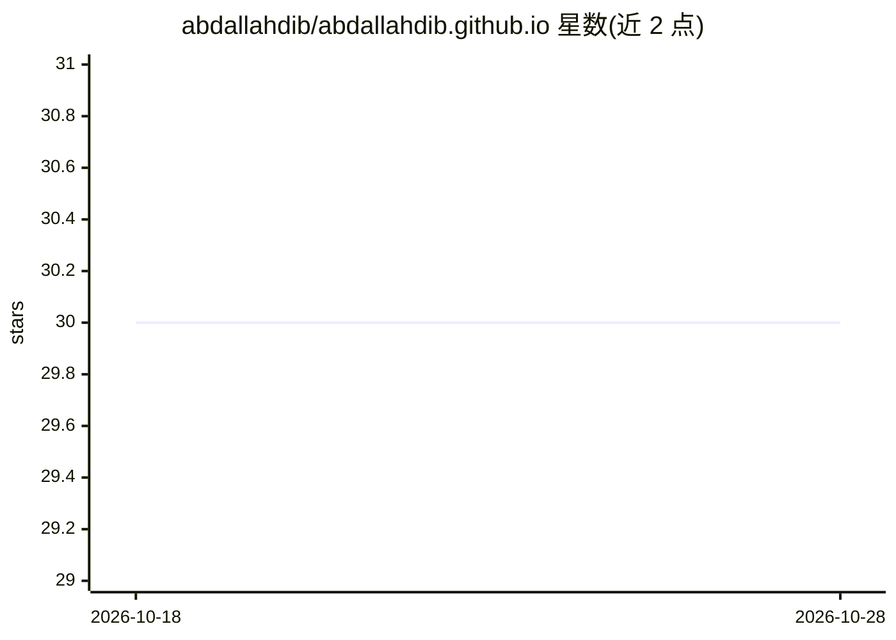

# abdallahdib/abdallahdib.github.io

⭐ 30 · HTML · 推送 2026-10-04 · [GitHub](https://github.com/abdallahdib/abdallahdib.github.io) · 个人维护

**计算机视觉研究科学家的个人学术主页（论文与项目汇集）**

Abdallah Dib 的 GitHub Pages 个人网站，作者任职于 Ubisoft La Forge（蒙特利尔），研究方向为面部捕捉、面部动画与游戏/交互娱乐中的 avatar 重建。站点以简历形式组织：About 介绍从业经历（InterDigital、Technicolor、Inria，2016 年 Inria 博士毕业），News 与 Publications 列出 CVPR/ICCV/SIGGRAPH Asia 等论文（Skullptor、SEREP、MoSAR、FaceLab 等）及开源库 NextFace/DeepNextFace 与 FFHQ-UV-Intrinsics 数据集链接，另有 C++/OpenGL 图形编程与 iOS 个人项目记录。站点为静态页面，无安装运行流程。

## 筛选速览

| 维度 | 判定 | 备注 |
|---|---|---|
| AI 角色 | `ai-knowledge` | 知识聚合/清单类 |
| 许可风险 | `none` | — |
| 部署形态 | `None` |  |
| 模型依赖 | — | README 未给出锁定关系 |
| 硬件要求 | — | 无带数字的原话,不猜 |
| 安装摩擦 | `low` | 无编译、无系统依赖或容器化 |
| 成熟度 | — | 结构信号不足 |

## 能力要点

- 汇集 2011-2026 年论文列表（CVPR/ICCV/EuroGraphics/SIGGRAPH Asia 等）与项目页链接
- 指向开源工作 NextFace / DeepNextFace（3D 人脸重建库）与 FFHQ-UV-Intrinsics 数据集
- 记录 C++/OpenGL 渲染引擎、OpenGLES 教程等图形编程个人项目

## 适用场景

- 了解作者在人脸捕捉与 avatar 重建方向的论文与开源工作
- 查找 3D 人脸重建相关数据集与代码入口
- 联系研究实习/博士合作机会

## 场景标签

 · 领域:计算机视觉/图形学研究

## 证据(README 行号)

> L6: I am a research scientist working at **Ubisoft La Forge** (Montreal). Previously, I worked as a Senior Research Scie
> L8: I develop methods for **face capture**, **facial animation**, and **avatar reconstruction** in video games and inter
> L26: ## Publications

## 星数曲线

2026-10-18 30 → 2026-10-28 30（+0）

---
*卡片 v1 · prompt 1.4 · 生成 2026-10-26 · 置信度 mid · 依据 README sha `1341a0c9cabe` · [字段定义](../../DATASET.md)*
