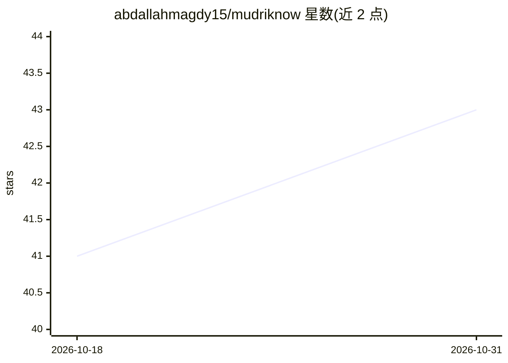

# abdallahmagdy15/mudriknow

⭐ 43 · TypeScript · MIT · 推送 2026-10-10 · [GitHub](https://github.com/abdallahmagdy15/mudriknow) · [官网](https://abdallahmagdy15.github.io/mudriknow/) · 个人维护

**读屏桌面 AI 代理：快捷键捕获窗口上下文，回答/操作/分步引导**

Electron 构建的开源 Windows 桌面 AI agent：按 Alt+Space 读取活动窗口的完整无障碍树（automationId、隐藏元数据）并截全屏带坐标网格的截图，交由多模态模型理解屏幕；随后在浮动面板中回答问题、执行允许清单内的 UI 操作，或以 Auto-Guide 模式用猫头鹰指针逐步引导用户完成任务。模型接入经 OpenCode 支持 140+ 提供商；AI 运行于沙箱，shell 只读、禁止文件写入。目前仅支持 Windows，安装包未签名，macOS/Linux 在路线图上。

## 筛选速览

| 维度 | 判定 | 备注 |
|---|---|---|
| AI 角色 | `ai-native` | 本体是模型或模型工具 |
| 许可风险 | `permissive` | MIT |
| 部署形态 | `desktop` | 安装包/桌面程序 |
| 模型依赖 | — | README 未给出锁定关系 |
| 硬件要求 | — | 无带数字的原话,不猜 |
| 安装摩擦 | `low` | 无编译、无系统依赖或容器化 |
| 成熟度 | — | 结构信号不足 |

## 能力要点

- 读取无障碍树 + 带坐标网格截图的双重屏幕上下文捕获
- Auto-Guide 模式：指针逐步引导用户完成多步 UI 任务
- 经 OpenCode 支持 140+ LLM 提供商（推荐多模态模型）
- 沙箱安全模型：只读 shell、禁止文件写入、UI 操作白名单

## 适用场景

- 在任意窗口中按快捷键获得基于屏幕上下文的 AI 回答
- 让 AI 分步教我完成不熟悉的软件操作
- 在浏览器、Office、IDE 中获得具备屏幕感知的助手

## 场景标签

`AI 助手` `GUI 自动化` · 领域:效率与自动化

## 证据(README 行号)

> L5: ***Stop explaining your screen to AI.*** **MudrikNow is an open-source desktop AI agent that sees what you see — and
> L28: Trigger the hotkey and MudrikNow reads the full accessibility tree of your active window — every button, field, lab
> L30: From there it's not just chat — it's an AI agent. Flip on **Auto-Guide** and it switches from *doing* to *teaching*

## 星数曲线

2026-10-18 41 → 2026-10-31 43（+2）

---
*卡片 v1 · prompt 1.4 · 生成 2026-10-25 · 置信度 high · 依据 README sha `691bed4879e5` · [字段定义](../../DATASET.md)*
