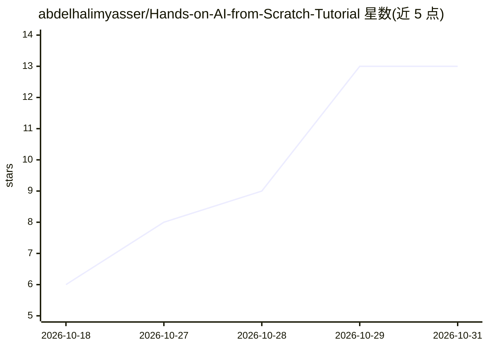

# abdelhalimyasser/Hands-on-AI-from-Scratch-Tutorial

⭐ 13 · Jupyter Notebook · MIT · 推送 2026-10-26 · [GitHub](https://github.com/abdelhalimyasser/Hands-on-AI-from-Scratch-Tutorial) · 个人维护

**AI/ML 从零实现教程仓库：C/MATLAB/Python 三语言学习路径**

长期建设中的 AI 与机器学习动手学习仓库，按“理论→直觉→数学→从零实现→可视化→实践→实验”的路径组织内容。三种语言各司其职：C 用于从零实现算法以揭示库内部机制，MATLAB 用于数学推导与可视化，Python 用于真实数据集上的实践工作流。规划覆盖数学基础、经典 ML、经典 AI、深度学习、NLP 及进阶主题；当前进度为线性代数部分（首个 notebook），仓库结构与主题列表仍在演进，以 MIT 许可发布。

## 筛选速览

| 维度 | 判定 | 备注 |
|---|---|---|
| AI 角色 | `ai-knowledge` | 知识聚合/清单类 |
| 许可风险 | `permissive` | MIT |
| 部署形态 | `None` |  |
| 模型依赖 | — | README 未给出锁定关系 |
| 硬件要求 | — | 无带数字的原话,不猜 |
| 安装摩擦 | `low` | 无编译、无系统依赖或容器化 |
| 成熟度 | `idea` | |

## 能力要点

- 三种语言分工：C 从零实现、MATLAB 数学可视化、Python 实践工作流
- 覆盖数学基础/经典ML/经典AI/深度学习/NLP 的规划范围与路线图
- 当前已发布线性代数 for ML 的首个 notebook（含向量化、范数、相似度等）

## 适用场景

- 系统学习 AI/ML 的数学原理与底层实现
- 通过 notebook 与实验从零理解算法而非仅调库
- 作为可反复回看的学习/复习参考资料

## 场景标签

`教程课程` · 领域:学习与行业

## 证据(README 行号)

> L3: A long-term, hands-on learning repository for understanding **Artificial Intelligence and Machine Learning from firs
> L15: **Theory → Intuition → Mathematics → From-Scratch Implementation → Visualization → Practical Implementation → Exper

## 星数曲线

2026-10-18 6 → 2026-10-31 13（+7）

---
*卡片 v1 · prompt 1.4 · 生成 2026-10-31 · 置信度 high · 依据 README sha `81b7ead7eaaa` · [字段定义](../../DATASET.md)*
