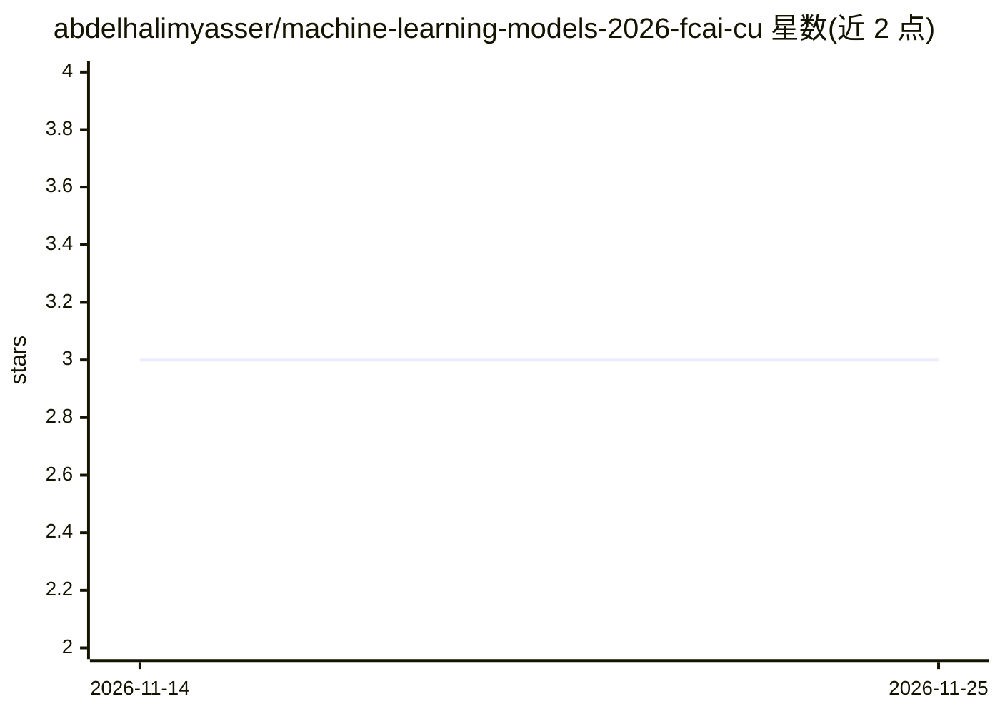

# abdelhalimyasser/machine-learning-models-2026-fcai-cu

⭐ 3 · Jupyter Notebook · 推送 2026-11-23 · [GitHub](https://github.com/abdelhalimyasser/machine-learning-models-2026-fcai-cu) · 个人维护

**开罗资本大学机器学习课程三个分类/回归模型作业仓库**

Capital大学计算与人工智能学院 AI-330 机器学习课程的团队项目仓库，按模块分为数值回归（a_regression）、图像分类（b_image_classifier）、文本分类（c_text_classifier）三部分，由六名成员分工完成。README 目前仅含课程信息、成员分工表与协作流程（clone、commit、push、pull），项目概述与文档要求部分标注待完成，依赖通过 venv 加 requirements.txt 安装。

## 筛选速览

| 维度 | 判定 | 备注 |
|---|---|---|
| AI 角色 | `ai-knowledge` | 知识聚合/清单类 |
| 许可风险 | `none` | — |
| 部署形态 | `library` | 以包/库形式分发 |
| 模型依赖 | — | README 未给出锁定关系 |
| 硬件要求 | — | 无带数字的原话,不猜 |
| 安装摩擦 | `low` | 无编译、无系统依赖或容器化 |
| 成熟度 | `idea` | |

## 能力要点

- 覆盖数值回归、图像分类、文本分类三个课程模块
- 六名成员按模块分工并登记 GitHub 账号
- 提供 git 协作流程与 venv 环境搭建步骤

## 适用场景

- 查看该课程三个机器学习作业模型的代码
- 作为课程团队协作仓库的模板参考

## 场景标签

 · 领域:教育/机器学习

## 证据(README 行号)

> L8: **Course:** Machine Learning (AI-330)
> L24: |Abdelhalim Yasser|@abdelhalimyasser|c_text_classifier|
> L14: - to be completed soon

## 星数曲线

2026-11-14 3 → 2026-11-25 3（+0）

---
*卡片 v1 · prompt 1.4 · 生成 2026-11-22 · 置信度 high · 依据 README sha `d2addc98b64b` · [字段定义](../../DATASET.md)*
