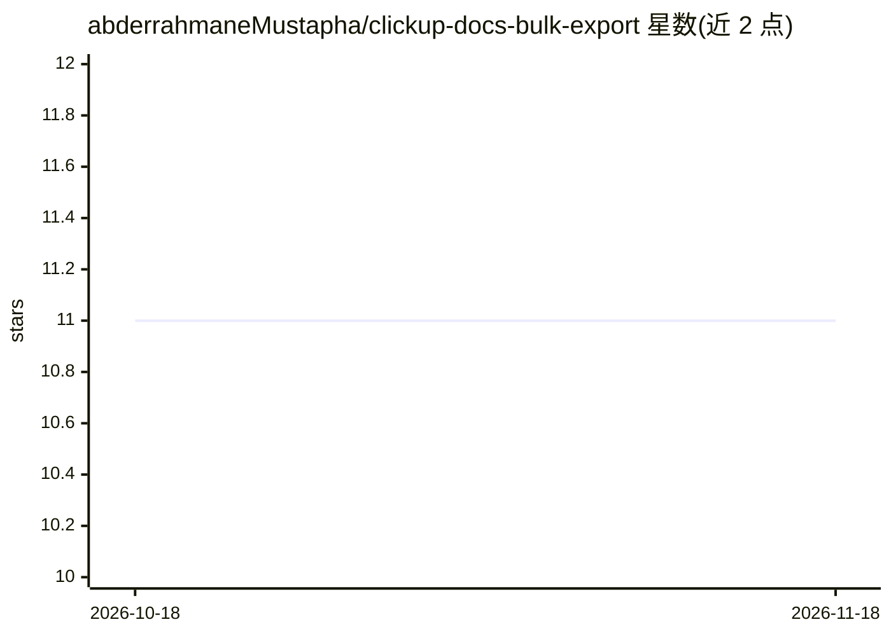

# abderrahmaneMustapha/clickup-docs-bulk-export

⭐ 11 · TypeScript · MIT · 推送 2026-01-29 · [GitHub](https://github.com/abderrahmaneMustapha/clickup-docs-bulk-export) · [官网](https://www.npmjs.com/package/clickup-docs-exporter) · 个人维护

**给 ClickUp 用户的文档/Wiki 批量导出为本地 Markdown 的 CLI 工具**

基于 Node.js 的命令行工具，通过 ClickUp API 读取工作区中的 Docs 与 Wikis，导出为标准 Markdown 文件并按原嵌套层级生成同名文件夹结构，每个文件附带 title/exported_at frontmatter。支持导出全部文档或按 ID 导出单个文档，自动处理 API 限流与重试，token 仅在本地使用不存储。需要 Node.js 18+ 与具备读权限的 ClickUp API token，可从源码运行或全局 npm 安装。

## 筛选速览

| 维度 | 判定 | 备注 |
|---|---|---|
| AI 角色 | `ai-enhanced` | 去掉 AI 部分产品仍成立 |
| 许可风险 | `permissive` | MIT |
| 部署形态 | `library` | 以包/库形式分发 |
| 模型依赖 | — | README 未给出锁定关系 |
| 硬件要求 | — | 无带数字的原话,不猜 |
| 安装摩擦 | `low` | 无编译、无系统依赖或容器化 |
| 成熟度 | — | 结构信号不足 |

## 能力要点

- 保留嵌套页面层级，导出为镜像的文件夹结构
- 导出全部文档或单个文档，Markdown 含 frontmatter
- 自动处理限流与重试，token 不落盘存储

## 适用场景

- 本地备份 ClickUp 文档副本
- 把文档迁移到其他平台
- 将文档作为 AI 工具的上下文语料

## 场景标签

 · 领域:文档/知识管理工具

## 证据(README 行号)

> L3: A CLI tool to export your ClickUp Docs and Wikis to local markdown files, preserving the full page hierarchy.
> L115: - **AI training** - Use your docs as context for AI tools

## 星数曲线

2026-10-18 11 → 2026-11-18 11（+0）

---
*卡片 v1 · prompt 1.4 · 生成 2026-11-18 · 置信度 high · 依据 README sha `18f7ac0e3313` · [字段定义](../../DATASET.md)*
