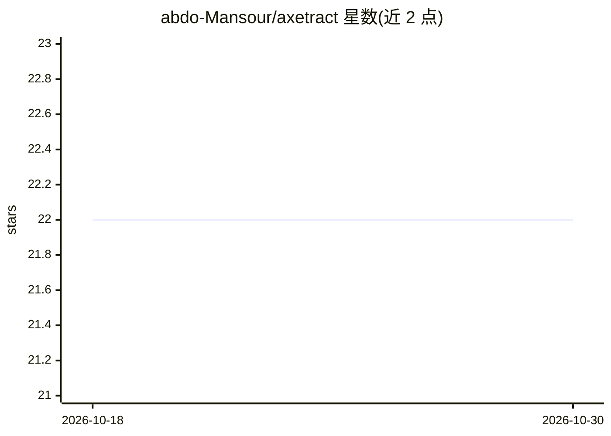

# abdo-Mansour/axetract

⭐ 22 · Python · MIT · 推送 2026-07-27 · [GitHub](https://github.com/abdo-Mansour/axetract) · [官网](https://abdo-mansour.github.io/axetract/) · 个人维护

**低成本跨领域网页结构化信息抽取框架（LoRA 适配器）**

基于论文 AXE 的结构化数据抽取框架：先用 LoRA 驱动的轻量 LLM 对 HTML 做剪枝过滤噪声节点，再用任务专用 LLM 将剪枝后内容映射为 JSON schema 或自然语言答案，并通过 Grounded XPath Resolution 将 JSON 字段映射回源 XPath 以供核验。支持 vLLM 与 HuggingFace 双引擎，附带 FastAPI 服务。以 pip 包与 CLI（axe-server）形式提供，MIT 许可。

## 筛选速览

| 维度 | 判定 | 备注 |
|---|---|---|
| AI 角色 | `ai-native` | 本体是模型或模型工具 |
| 许可风险 | `permissive` | MIT |
| 部署形态 | `library` | 以包/库形式分发 |
| 模型依赖 | local-ok | 支持本地模型 |
| 硬件要求 | — | 无带数字的原话,不猜 |
| 安装摩擦 | `low` | 无编译、无系统依赖或容器化 |
| 成熟度 | — | 结构信号不足 |

## 能力要点

- LoRA 适配器两阶段管线：DOM 剪枝 + 结构化抽取
- GXR 将抽取的 JSON 字段映射回源 XPath
- 支持 vLLM 与 HuggingFace 双引擎
- 内置 FastAPI 服务（axe-server），环境变量配置

## 适用场景

- 从电商、房产、列表类网页抽取结构化数据
- 以小模型（如 Qwen3-0.6B）低成本跑抽取管线
- 把抽取结果回溯到 DOM 源位置做核验

## 场景标签

`网页抓取` · 领域:效率与自动化

## 证据(README 行号)

> L16: **AXEtract** is a high-performance, low-cost framework for extracting structured data from web pages. Based on the 
> L32:  - **Pruner**: A lightweight LLM (LoRA-powered) filters out noise and selects only relevant HTML chunks.

## 星数曲线

2026-10-18 22 → 2026-10-30 22（+0）

---
*卡片 v1 · prompt 1.4 · 生成 2026-10-27 · 置信度 high · 依据 README sha `5218d43477f8` · [字段定义](../../DATASET.md)*
