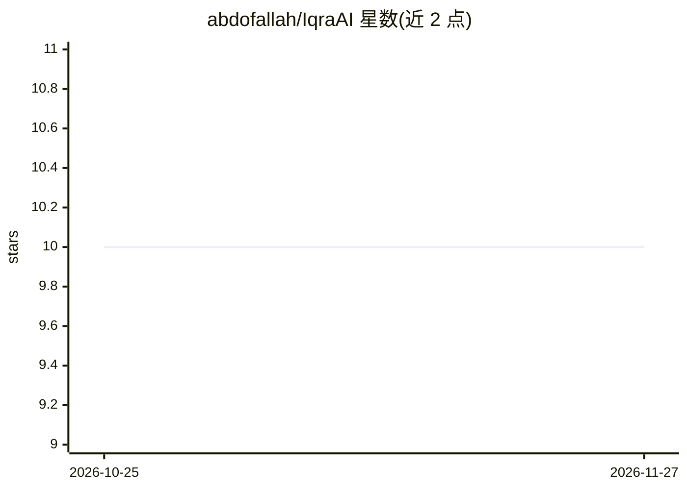

# abdofallah/IqraAI

⭐ 10 · C# · NOASSERTION · 推送 2026-11-23 · [GitHub](https://github.com/abdofallah/IqraAI) · [官网](https://www.iqra.bot) · 组织维护

**无代码编排语音/对话 Agent 的平台，供企业构建可靠对话系统**

Iqra AI 定位为 LLM 与业务代码之间的编排基础设施，提供可视化无代码编辑器构建语音与对话 Agent。核心机制包括确定性逻辑层（在对话中嵌入 If/Else、循环等工作流）、多语言并行上下文切换、多区域路由降低 RTP 延迟、PCI-DSS 安全会话（AI 不接触原始敏感数据）、以及 BYOM 模型适配器接口。提供 Cloud 托管版（含计费/白标模块）、自托管开源版（不含商业模块）与企业版三种部署方式，自托管依赖 .NET 10、MongoDB、Redis、Milvus、RustFS。

## 筛选速览

| 维度 | 判定 | 备注 |
|---|---|---|
| AI 角色 | `ai-ecosystem` | LLM/agent 周边工具 |
| 许可风险 | `none` | NOASSERTION |
| 部署形态 | `None` |  |
| 模型依赖 | locked-api |  |
| 硬件要求 | — | 无带数字的原话,不猜 |
| 安装摩擦 | `high` | 编译与系统依赖俱全 |
| 成熟度 | — | 结构信号不足 |

## 能力要点

- 无代码图形编辑器，暴露系统提示词、变量状态与工具定义的细粒度控制
- 确定性逻辑层处理条件路由/循环/数学运算，AI 对话与执行逻辑分离
- 多语言并行逻辑栈，可在句中即时切换不同语言/人格配置
- 模块化 BYOM 架构，原生适配 OpenAI/Azure/Gemini/Anthropic/Groq/ElevenLabs/Deepgram，支持自定义模型端点

## 适用场景

- 搭建呼入/呼出的多语言语音客服 Agent
- 在对话流程中安全采集支付等敏感信息
- 通过 SIP 或 WebRTC 网关将 Agent 部署到电话与浏览器/移动端
- 以插件形式将外部 API（如 Cal.com、HubSpot）接入对话流程

## 场景标签

`语音 Agent` `工作流自动化` · 领域:效率与自动化

## 证据(README 行号)

> L36: **Iqra AI** is an orchestration infrastructure designed to bridge the gap between the chaos of LLMs and the reliabi
> L48: **Requirements:** .NET 10 Runtime, MongoDB, Redis, Milvus, RustFS (S3).
> L74: A modular **Bring Your Own Model (BYOM)** architecture. We provide native, optimized adapters for industry leaders 

## 星数曲线

2026-10-25 10 → 2026-11-27 10（+0）

---
*卡片 v1 · prompt 1.4 · 生成 2026-11-20 · 置信度 high · 依据 README sha `67a49cf5c899` · [字段定义](../../DATASET.md)*
