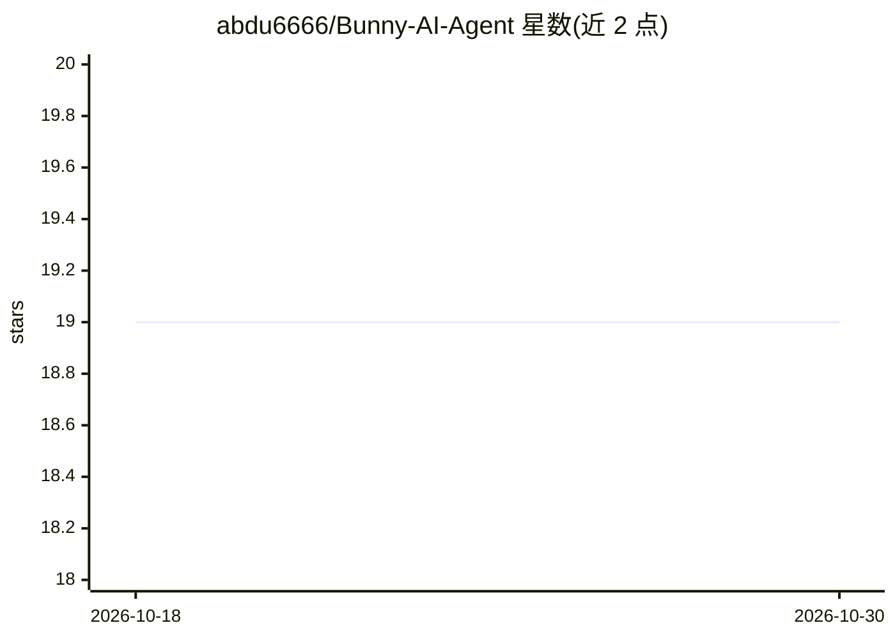

# abdu6666/Bunny-AI-Agent

⭐ 19 · TypeScript · Apache-2.0 · 推送 2026-06-15 · [GitHub](https://github.com/abdu6666/Bunny-AI-Agent) · [官网](https://buda.im) · 个人维护

**基于 Pi 的多模型编码 Agent CLI，支持远程沙箱与自建产品**

TypeScript 编写的编码代理，构建于 Pi Coding Agent 之上，支持在 Claude、Gemini、OpenAI 等多家模型间切换而无需改代码。三种使用形态：本地 CLI 编码助手、`bunny remote` 一键启动的云端沙箱（Sandock/E2B/Daytona，$5/月起）、通过 SDK 嵌入 Next.js 或桌面应用构建自己的 Agent 产品。stdout 直接输出 AI SDK UI 流，可对接 useChat() 前端。内置 Web 搜索、Bash 执行、文件读写等工具，会话按 id 持久化可恢复；附 GAIA 基准评测结果与集成评测 harness。Apache 2.0 许可。

## 筛选速览

| 维度 | 判定 | 备注 |
|---|---|---|
| AI 角色 | `ai-native` | 本体是模型或模型工具 |
| 许可风险 | `permissive` | Apache-2.0 |
| 部署形态 | `library` | 以包/库形式分发 |
| 模型依赖 | locked-api |  |
| 硬件要求 | — | 无带数字的原话,不猜 |
| 安装摩擦 | `low` | 无编译、无系统依赖或容器化 |
| 成熟度 | — | 结构信号不足 |

## 能力要点

- 一条 CLI 在 Claude/Gemini/OpenAI 等多模型间切换
- stdout 原生输出 AI SDK UI 流，useChat() 直接对接
- bunny remote 一键启动云端沙箱（Sandock/E2B/Daytona/本地四种适配器）
- 附 GAIA 基准评测 harness，支持错题跟踪与逐题迭代

## 适用场景

- 在终端里用自然语言驱动多模型完成编码任务
- 本地机器配置不足时在云端沙箱运行 Agent
- 用 SDK 把编码 Agent 嵌入自己的 SaaS 或桌面产品

## 场景标签

`编码 Agent` · 领域:编码与开发

## 证据(README 行号)

> L19: **Bunny Agent** is a coding agent built on Pi Coding Agent — multi-model, harness-ready, and designed from the grou
> L23: |🖥️ **Daily CLI agent**|Install and use it like a local coding assistant, today|
> L33: Switch between Claude, Gemini, OpenAI, or any provider — no code changes required.

## 星数曲线

2026-10-18 19 → 2026-10-30 19（+0）

---
*卡片 v1 · prompt 1.4 · 生成 2026-10-29 · 置信度 high · 依据 README sha `77d12035250e` · [字段定义](../../DATASET.md)*
