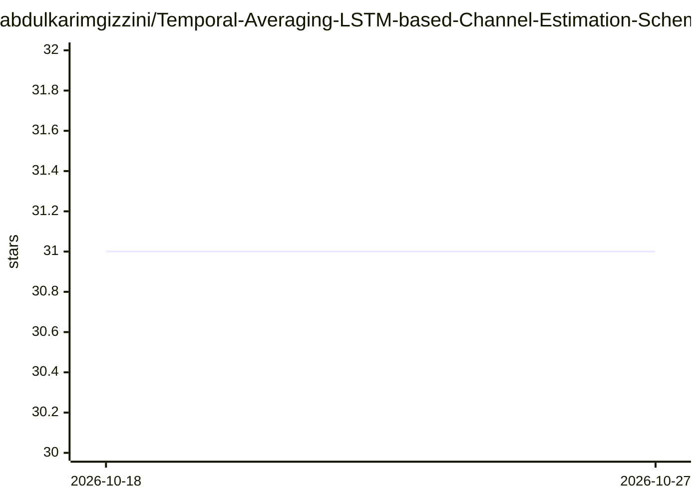

# abdulkarimgizzini/Temporal-Averaging-LSTM-based-Channel-Estimation-Scheme-for-IEEE-802.11p-Standard

⭐ 31 · MATLAB · GPL-3.0 · 推送 2026-01-28 · [GitHub](https://github.com/abdulkarimgizzini/Temporal-Averaging-LSTM-based-Channel-Estimation-Scheme-for-IEEE-802.11p-Standard) · 个人维护

**IEEE 802.11p 车联网信道估计的 LSTM 方案论文源码**

复现 GLOBECOM 2021 论文的源码仓库：提出数据导频辅助（DPA）加时间平均（TA）再接 LSTM 的信道估计方案，用于 IEEE 802.11p 车联网 OFDM 通信。Matlab 实现 Tx-Rx OFDM 处理与预定义车辆信道模型（如 VTV_SDWW），Python/PyTorch 实现 LSTM 训练与测试，两者通过数据集文件衔接。运行需按步骤依次执行 Matlab 脚本生成数据集，再以命令行参数执行 LSTM.py 完成训练与测试，最终计算 BER 与 NMSE。面向科研复现者，限制为依赖 Matlab 与 PyTorch 双环境。

## 筛选速览

| 维度 | 判定 | 备注 |
|---|---|---|
| AI 角色 | `ai-native` | 本体是模型或模型工具 |
| 许可风险 | `viral` | GPL-3.0 |
| 部署形态 | `None` |  |
| 模型依赖 | — | README 未给出锁定关系 |
| 硬件要求 | — | 无带数字的原话,不猜 |
| 安装摩擦 | `low` | 无编译、无系统依赖或容器化 |
| 成熟度 | — | 结构信号不足 |

## 能力要点

- DPA-TA 信道估计与 LSTM 估计器实现
- Matlab OFDM 仿真与 PyTorch LSTM 双部分组成
- 支持指定移动性场景、信道模型、调制阶数等命令行参数
- 输出 BER 与 NMSE 指标计算

## 适用场景

- 复现论文中的 LSTM 信道估计实验
- 在 IEEE 802.11p 车联网场景下评估信道估计性能
- 基于已有代码开展信道估计方法研究

## 场景标签

`科研工具` · 领域:学习与行业

## 证据(README 行号)

> L1: This repository includes the source code of the LSTM-based channel estimators proposed in "Temporal Averaging LSTM-b
> L9: - LSTM.py: The LSTM training/testing is performed employing the generated training/testing datasets. The file should

## 星数曲线

2026-10-18 31 → 2026-10-27 31（+0）

---
*卡片 v1 · prompt 1.4 · 生成 2026-10-26 · 置信度 high · 依据 README sha `8c5c77b016c0` · [字段定义](../../DATASET.md)*
