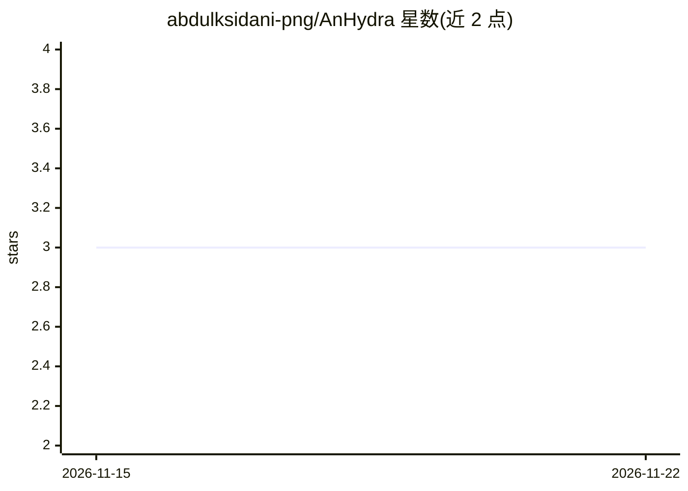

# abdulksidani-png/AnHydra

⭐ 3 · TypeScript · MIT · 推送 2026-11-15 · [GitHub](https://github.com/abdulksidani-png/AnHydra) · [官网](https://anhydra.work) · 个人维护

**给生物研究者用的蛋白质耐干燥家族分类打分工具**

Web 应用（FastAPI 后端 + React 前端），用户粘贴 20–1,022 残基的氨基酸序列，得到 CAHS/LEA 类耐干燥保护蛋白的家族分类分数与解释。流程为 ESM-2（35M 冻结权重）线性探针嵌入，配并行可解释生物物理模型，Gemini 生成平白语言读出。采用按序列簇划分的交叉验证与整家族留出基准，与 BLAST、CNN 基线对比。README 明确其定位为家族分类与筛选工具，非保护效力预测器；分数为未校准的分类器输出，部署需 Auth0 与 PostgreSQL（本地开发模式可绕过）。

## 筛选速览

| 维度 | 判定 | 备注 |
|---|---|---|
| AI 角色 | `ai-native` | 本体是模型或模型工具 |
| 许可风险 | `permissive` | MIT |
| 部署形态 | `library` | 以包/库形式分发 |
| 模型依赖 | — | README 未给出锁定关系 |
| 硬件要求 | — | 无带数字的原话,不猜 |
| 安装摩擦 | `low` | 无编译、无系统依赖或容器化 |
| 成熟度 | — | 结构信号不足 |

## 能力要点

- ESM-2 冻结权重线性探针分类，CPU 即可嵌入
- 整家族留出基准与 BLAST/CNN 基线对比实验
- 从零训练的 CNN 自主恢复已发表的 dehydrin K-segment 基序
- 无 Gemini API key 时回退到本地模板解释

## 适用场景

- 筛选候选序列是否属于耐干燥保护蛋白家族
- 疫苗、凝血因子等生物制剂常温保存的蛋白筛选研究
- 对比语言模型与 BLAST 在留出家族上的表现

## 场景标签

`科研工具` · 领域:学习与行业

## 证据(README 行号)

> L11: chain. AnHydra scores any amino-acid sequence for that character and explains the score in plain
> L14: > **Read this first.** AnHydra is a **family classifier and triage tool**, not an efficacy predictor.
> L32: |Protective IDPs vs. *other disordered* proteins, matched on disorder and length|ESM-2 protein language model → a 4

## 星数曲线

2026-11-15 3 → 2026-11-22 3（+0）

---
*卡片 v1 · prompt 1.4 · 生成 2026-11-22 · 置信度 high · 依据 README sha `295a5fdb04aa` · [字段定义](../../DATASET.md)*
