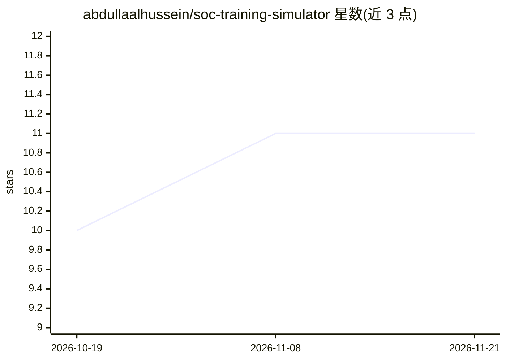

# abdullaalhussein/soc-training-simulator

⭐ 11 · TypeScript · MIT · 推送 2026-04-09 · [GitHub](https://github.com/abdullaalhussein/soc-training-simulator) · [官网](https://github.com/abdullaalhussein/soc-training-simulator) · 个人维护 · 中文 README

**自托管 SOC 分析师培训平台，含 13 个内置场景**

面向 SOC 分析师培训的自托管 Web 平台：提供 13 个内置调查场景、10 类仿真日志、8 种检查点题型、MITRE ATT&CK 映射与三角色（管理员/培训师/学员）体系；培训师可经 Socket.io 实时监控并下发提示，评分覆盖五个维度并导出 PDF/CSV 报告。AI 功能（导师、评分、场景生成）通过用户自备 Anthropic API key 启用；无 key 时平台除 AI 功能外全部可用。技术栈为 Next.js、Express、PostgreSQL、Prisma，MIT 许可，另提供企业托管/SSO 等付费服务。

## 筛选速览

| 维度 | 判定 | 备注 |
|---|---|---|
| AI 角色 | `ai-enhanced` | 去掉 AI 部分产品仍成立 |
| 许可风险 | `permissive` | MIT |
| 部署形态 | `None` |  |
| 模型依赖 | locked-api |  |
| 硬件要求 | — | 无带数字的原话,不猜 |
| 安装摩擦 | `low` | 无编译、无系统依赖或容器化 |
| 成熟度 | — | 结构信号不足 |

## 能力要点

- 13 个内置场景覆盖钓鱼、暴力破解、DNS 隧道、SQL 注入等类型
- AI SOC Mentor 以苏格拉底式提问引导，不直接给出答案
- 培训师经 Socket.io 实时监控学员并支持五维评分与 PDF/CSV 报告
- 无 API key 时平台功能完整，AI 功能显示不可用状态

## 适用场景

- 为安全团队新入职分析师组织事件响应演练
- 培训师创建会话并实时监控、调整学员评分
- 用 AI 场景生成器从文本描述生成自定义训练场景

## 场景标签

`网络安全` · 领域:学习与行业

## 证据(README 行号)

> L5:  An open-source platform that prepares SOC analysts for real incidents before they face one.
> L89: - **Graceful degradation** — platform is fully functional without an API key; AI features show "unavailable" state
> L148: **Without an API key**, the platform is fully functional — all investigation, scoring, checkpoint, evidence, YARA,

## 星数曲线

2026-10-19 10 → 2026-11-21 11（+1）

---
*卡片 v1 · prompt 1.4 · 生成 2026-11-18 · 置信度 high · 依据 README sha `17ba8188d821` · [字段定义](../../DATASET.md)*
