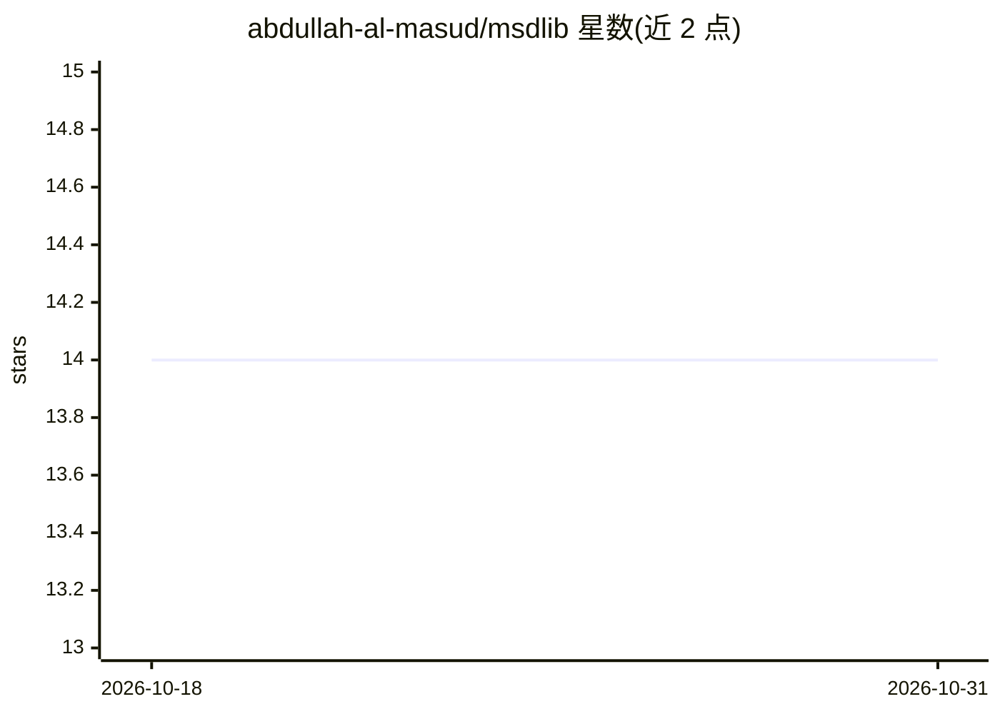

# abdullah-al-masud/msdlib

⭐ 14 · HTML · MIT · 推送 2026-07-28 · [GitHub](https://github.com/abdullah-al-masud/msdlib) · [官网](https://msdlib.readthedocs.io/) · 个人维护

**数据处理/可视化与 Pytorch 机器学习辅助 Python 库**

面向初中级开发者的数据科学辅助库，分四部分：基于 Pytorch 的深度学习工具（fit/predict/evaluate 接口、自动生成分类指标表与回归图）、超参数网格/随机搜索、数据集划分（含适合 RNN/LSTM 的 sequence_split）、特征重要性评估；可视化（散点矩阵、时间序列、热力图）；数据处理（低通等滤波器、频谱图）；金融回测模块仍在开发中。pip 安装，Pytorch 需手动安装，要求 Python>=3.8，MIT 许可。

## 筛选速览

| 维度 | 判定 | 备注 |
|---|---|---|
| AI 角色 | `ai-ecosystem` | LLM/agent 周边工具 |
| 许可风险 | `permissive` | MIT |
| 部署形态 | `library` | 以包/库形式分发 |
| 模型依赖 | — | README 未给出锁定关系 |
| 硬件要求 | — | 无带数字的原话,不猜 |
| 安装摩擦 | `low` | 无编译、无系统依赖或容器化 |
| 成熟度 | `idea` | |

## 能力要点

- Scikit 风格的 Pytorch 模型 fit/predict/evaluate 接口
- grid/random 超参数搜索与多种数据集划分方式
- 统计角度的特征重要性评估（分类与回归标签均支持）
- 信号滤波（低通/高通/带通/带阻）与频谱图生成

## 适用场景

- 用少量代码训练和评估 Pytorch 分类/回归模型
- 对时间序列数据做滤波与频谱分析
- 评估特征重要性并可视化结果

## 场景标签

 · 领域:数据科学/机器学习工具库

## 证据(README 行号)

> L7: The main purpose of this library is to make data science works easier and simpler with less amount of coding, provid
> L56: 1. Machine learning tools
> L67: This module provides functionalities for easier implementation of Pytorch Deep Learning models. It offers several f

## 星数曲线

2026-10-18 14 → 2026-10-31 14（+0）

---
*卡片 v1 · prompt 1.4 · 生成 2026-10-31 · 置信度 high · 依据 README sha `047b430301b9` · [字段定义](../../DATASET.md)*
