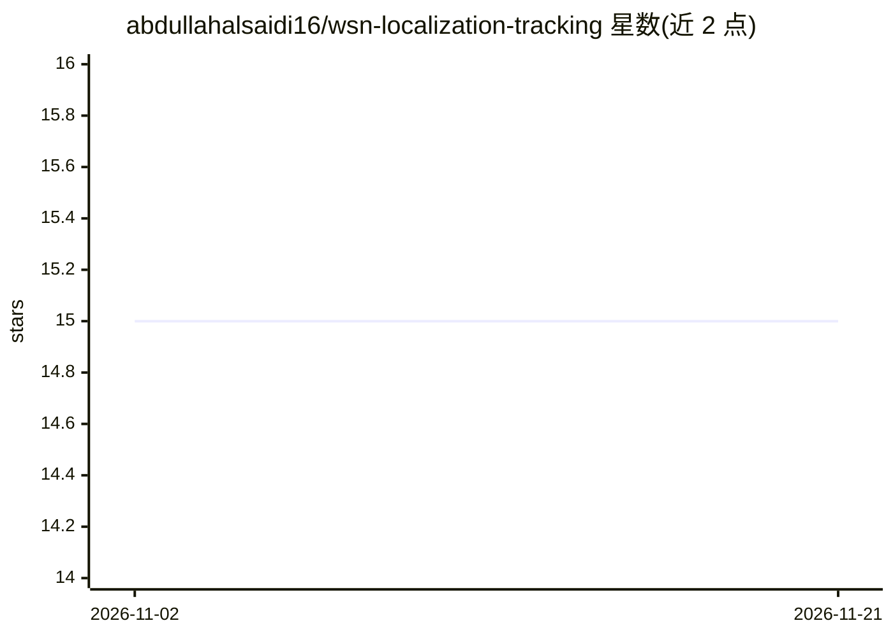

# abdullahalsaidi16/wsn-localization-tracking

⭐ 15 · Python · GPL-3.0 · 推送 2026-11-01 · [GitHub](https://github.com/abdullahalsaidi16/wsn-localization-tracking) · 个人维护

**无线传感网络中基于 RSSI 的目标定位与跟踪毕业设计项目**

大马士革大学毕业设计：在 200×200 米仿真场地的 16 个锚节点上，从 RSSI 信号学习目标位置映射，采用 SVM 回归与 Random Fourier Features 核近似两种估计器，并用卡尔曼滤波结合目标加速度计逐步平滑为轨迹。研究了 1/2/3 阶运动模型，RFF 在约 60 个分量时达到与完整 SVM 相当的精度。仓库含网络生成、模型调参、RFF 实验、轨迹生成与结果图表模块，运行 main.py 复现整个研究。注意入口脚本文件名带前导空格需加引号。

## 筛选速览

| 维度 | 判定 | 备注 |
|---|---|---|
| AI 角色 | `ai-native` | 本体是模型或模型工具 |
| 许可风险 | `viral` | GPL-3.0 |
| 部署形态 | `None` |  |
| 模型依赖 | — | README 未给出锁定关系 |
| 硬件要求 | — | 无带数字的原话,不猜 |
| 安装摩擦 | `low` | 无编译、无系统依赖或容器化 |
| 成熟度 | — | 结构信号不足 |

## 能力要点

- SVM 与 Random Fourier Features 两种位置估计器
- 卡尔曼滤波（1/2/3 阶运动模型）平滑轨迹
- RFF 约 60 分量即达到与完整 SVM 相当精度
- 16 锚点仿真网络与 RSSI 训练数据生成

## 适用场景

- 复现基于 RSSI 的无线传感网络定位与跟踪研究
- 比较核近似方法（RFF）与 SVM 回归的成本与精度
- 作为 WSN 定位课程或毕业设计的参考实现

## 场景标签

 · 领域:无线传感网络/机器学习

## 证据(README 行号)

> L8: So the mapping is **learned** instead: an SVM regressor, and a Random Fourier Features
> L10: repeatedly over time, with a **Kalman filter** and the target's accelerometer smoothing the

## 星数曲线

2026-11-02 15 → 2026-11-21 15（+0）

---
*卡片 v1 · prompt 1.4 · 生成 2026-11-18 · 置信度 high · 依据 README sha `4ef25100b42b` · [字段定义](../../DATASET.md)*
