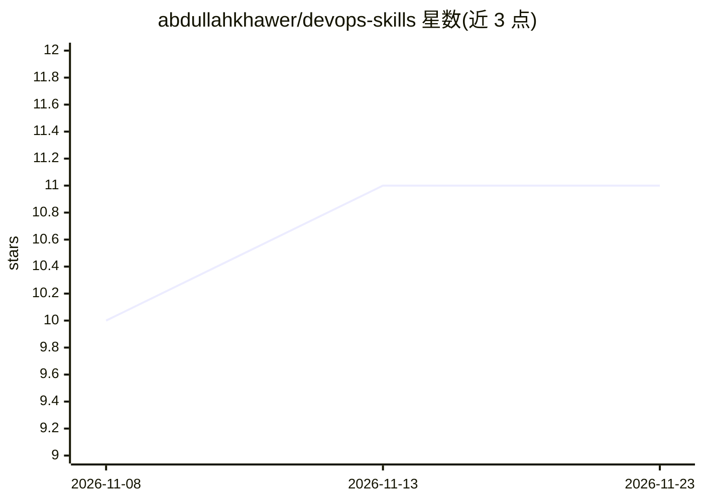

# abdullahkhawer/devops-skills

⭐ 11 · Apache-2.0 · 推送 2026-09-22 · [GitHub](https://github.com/abdullahkhawer/devops-skills) · 个人维护

**面向开发者的 DevOps AI agent 技能集合（SKILL.md）**

devops-skills 是一组可复用的 DevOps 技能指令文件（SKILL.md），供 Claude Code、GitHub Copilot、Cursor 等主流 AI agent 产品加载使用；每个技能将 agent 构建为具备特定 DevOps 知识的助手，覆盖代码审查、提交、Linting、Kubernetes/Terraform/Helm 等 CLI 操作、多家云厂商、可观测性与数据库平台。技能通过各平台原生 CLI 或 HTTP API 交互，无需 MCP server；另附 Claude Code 安全 guardrails 配置，默认只读并阻止破坏性命令。使用方式为复制 SKILL.md 到对应 agent 目录并替换占位符。

## 筛选速览

| 维度 | 判定 | 备注 |
|---|---|---|
| AI 角色 | `ai-knowledge` | 知识聚合/清单类 |
| 许可风险 | `permissive` | Apache-2.0 |
| 部署形态 | `self-host` | docker 或自建部署 |
| 模型依赖 | — | README 未给出锁定关系 |
| 硬件要求 | — | 无带数字的原话,不猜 |
| 安装摩擦 | `low` | 无编译、无系统依赖或容器化 |
| 成熟度 | — | 结构信号不足 |

## 能力要点

- SKILL.md 格式技能可跨 Claude Code、GitHub Copilot、Cursor 等 agent 产品使用
- 技能经平台原生 CLI 或 HTTP API 操作 GitHub/Jenkins/Grafana/AWS 等平台，无需 MCP server
- 附 Claude Code deny/allow 安全 guardrails，默认只读并阻断删除/供应/IAM 变更等操作
- 按类别组织技能：开发工具、Linting、基础设施、云厂商、可观测性、数据库、项目管理等

## 适用场景

- 让 AI agent 执行 Git 分支对比与代码审查、生成规范 commit
- 通过 agent 调用 kubectl/terraform/helm 等 CLI 完成基础设施操作
- 在 Claude Code 中配置安全规则阻止破坏性命令执行
- 为不同云厂商 CLI 配置正确的 profile/region 用法指引

## 场景标签

`代码审查` `编码 Agent` · 领域:编码与开发

## 证据(README 行号)

> L7: `devops-skills` is a curated collection of **DevOps Skills** that enhance your development using AI to work smarter.
> L9: **Skills** are reusable, step-by-step instruction files (`SKILL.md`) that can be used across almost every major AI a
> L22: # 🚀 Available Skills

## 星数曲线

2026-11-08 10 → 2026-11-23 11（+1）

---
*卡片 v1 · prompt 1.4 · 生成 2026-11-18 · 置信度 mid · 依据 README sha `8bbfb6cc5dc5` · [字段定义](../../DATASET.md)*
