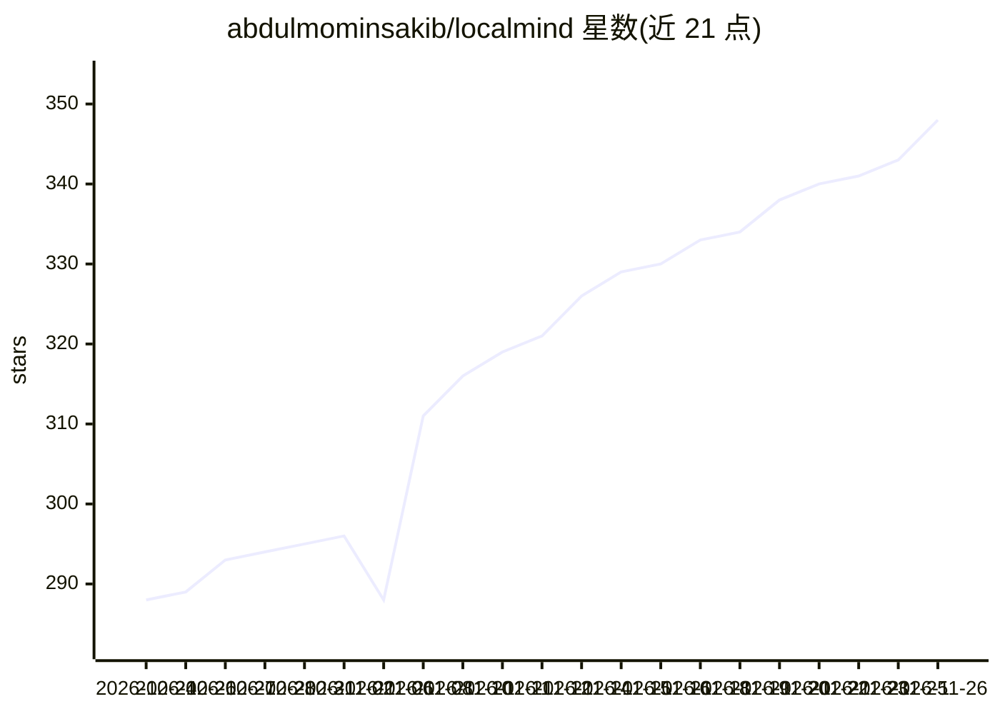

# abdulmominsakib/localmind

⭐ 348 · Dart · MIT · 推送 2026-11-25 · [GitHub](https://github.com/abdulmominsakib/localmind) · 个人维护

**移动端本地/云端 LLM 聊天客户端，支持离线运行 GGUF 模型**

基于 Flutter 的开源 Android/iOS LLM 聊天应用，MIT 许可。可在手机上完全离线运行 GGUF（经 llama.cpp/llamadart）与 LiteRT 模型，也可连接 Ollama、LM Studio、OpenRouter、Requesty 或任意 OpenAI 兼容服务器，内置 MCP 工具支持。功能包括模型管理（可从 HuggingFace 直接下载 GGUF）、多服务器连接与健康监测、语音输入输出、多模态附件、人设管理、对话全文检索与本地备份。源码经 FVM 固定 Flutter 3.44 构建，应用商店与 GitHub Releases 提供安装包。

## 筛选速览

| 维度 | 判定 | 备注 |
|---|---|---|
| AI 角色 | `ai-native` | 本体是模型或模型工具 |
| 许可风险 | `permissive` | MIT |
| 部署形态 | `None` |  |
| 模型依赖 | local-ok | 支持本地模型 |
| 硬件要求 | — | 无带数字的原话,不猜 |
| 安装摩擦 | `low` | 无编译、无系统依赖或容器化 |
| 成熟度 | — | 结构信号不足 |

## 能力要点

- Android/iOS 离线运行 GGUF 与 LiteRT 模型（llamadart + flutter_gemma）
- 内置 MCP 支持，可为模型接入自定义工具
- Android 本地 API：将已加载模型以 OpenAI 兼容端点提供给其他应用
- 15 种语言界面，S3 端到端加密云同步（仅连用户自控的桶）

## 适用场景

- 在手机上离线运行本地模型进行私密对话
- 通过一个客户端统一连接 Ollama、LM Studio 与云服务商
- 为视觉模型附加照片与文档进行多模态提问
- 为模型配置 MCP 工具（文件访问、Web API 等）

## 场景标签

`聊天机器人` `AI 助手` · 领域:对话与助手

## 证据(README 行号)

> L5: LocalMind is an open-source Android and iOS chat app for LLMs. Run GGUF and LiteRT models fully offline on your phon
> L43: - **On-Device AI Support (iOS & Android)**: Private, fast, and offline. Run powerful GGUF and LiteRT models (Gemma,
> L47: - **Multi-Server Connection**: Connect to Ollama, LM Studio, OpenRouter, Requesty, Standard Compute, or any OpenAI-

## 星数曲线

2026-10-24 288 → 2026-11-26 348（+60）

---
*卡片 v1 · prompt 1.4 · 生成 2026-11-25 · 置信度 high · 依据 README sha `7ac94ab7c564` · [字段定义](../../DATASET.md)*
