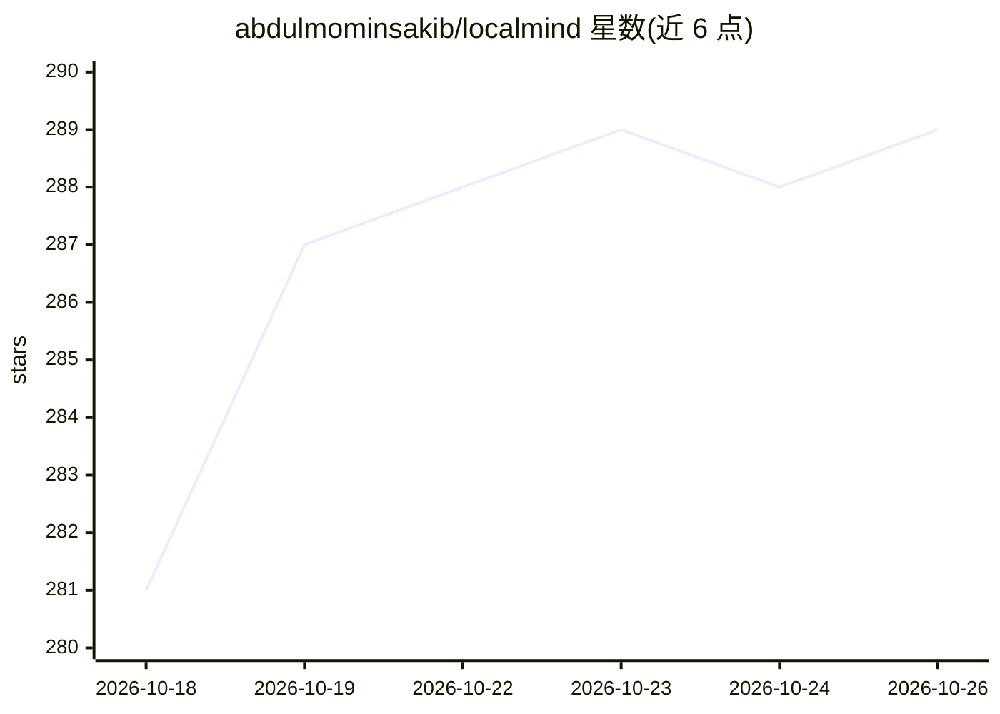

# abdulmominsakib/localmind

⭐ 289 · Dart · MIT · 推送 2026-10-23 · [GitHub](https://github.com/abdulmominsakib/localmind) · 个人维护

**移动端本地 LLM 聊天客户端：离线跑 GGUF 模型或连接自有服务器**

基于 Flutter 3.44 的 Android/iOS 开源聊天应用：通过 llamadart（llama.cpp）与 flutter_gemma（LiteRT）在设备上离线运行 GGUF 与 Gemma 模型，或连接 Ollama、LM Studio、OpenRouter、Requesty 及任意 OpenAI 兼容服务器。内置 MCP 工具支持（文件访问、Web API、shell 动作）、模型管理器（含从 HuggingFace 下载 GGUF）、流式响应、Markdown 渲染、STT/TTS、多模态附件、persona 管理与可选端到端加密 S3 同步。隐私上无分析埋点，对话仅存本地。提供 App Store、Google Play 与 GitHub Releases APK 安装包，源码经 FVM + Flutter 构建。

## 筛选速览

| 维度 | 判定 | 备注 |
|---|---|---|
| AI 角色 | `ai-ecosystem` | LLM/agent 周边工具 |
| 许可风险 | `permissive` | MIT |
| 部署形态 | `None` |  |
| 模型依赖 | local-ok | 支持本地模型 |
| 硬件要求 | — | 无带数字的原话,不猜 |
| 安装摩擦 | `low` | 无编译、无系统依赖或容器化 |
| 成熟度 | — | 结构信号不足 |

## 能力要点

- 设备端离线推理：GGUF（llamadart/llama.cpp）与 LiteRT（flutter_gemma）
- MCP 工具支持：本地/远程 MCP 服务器，细粒度权限开关
- 多后端连接：Ollama/LM Studio/OpenRouter/Requesty/OpenAI 兼容 API，含服务器健康监控
- STT/TTS 语音输入输出、多模态附件与 persona 管理

## 适用场景

- 在手机上完全离线与本地 GGUF 模型对话
- 把手机作为连接家里 Ollama/LM Studio 服务器的聊天客户端
- 通过 MCP 让本地模型调用自定义工具

## 场景标签

`聊天机器人` · 领域:对话与助手

## 证据(README 行号)

> L5: LocalMind is an open-source Android and iOS chat app for LLMs. Run GGUF and LiteRT models fully offline on your phon
> L45: - **Multi-Server Connection**: Connect to Ollama, LM Studio, OpenRouter, Requesty, or any OpenAI-compatible API wit

## 星数曲线

2026-10-18 281 → 2026-10-26 289（+8）

---
*卡片 v1 · prompt 1.4 · 生成 2026-10-22 · 置信度 high · 依据 README sha `a63963c2e196` · [字段定义](../../DATASET.md)*
