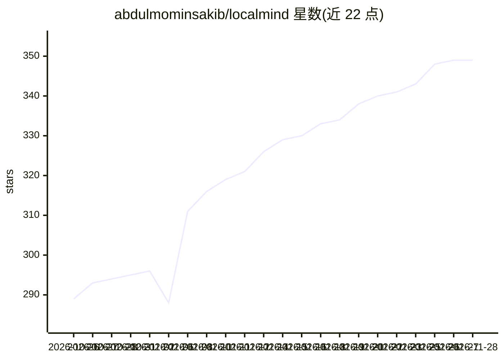

# abdulmominsakib/localmind

⭐ 349 · Dart · MIT · 推送 2026-11-25 · [GitHub](https://github.com/abdulmominsakib/localmind) · 个人维护

**面向 iOS/Android 用户的本地与离线 LLM 聊天客户端**

基于 Flutter 的开源聊天应用，提供两条使用路径：在手机上离线运行 GGUF（llama.cpp 内核）与 LiteRT 模型，或连接 Ollama、LM Studio、OpenRouter、Requesty 等本地/云端后端，并可接入任意 OpenAI 兼容服务器。功能覆盖 MCP 工具调用、语音转文字与合成、图片文档附件的多模态输入、对话历史搜索与本地存储、S3 端到端加密同步，以及 15 种语言界面。Android 端还提供本地 OpenAI 兼容 API 供其他应用调用。源码构建需 FVM 固定的 Flutter 3.44 环境。

## 筛选速览

| 维度 | 判定 | 备注 |
|---|---|---|
| AI 角色 | `ai-native` | 本体是模型或模型工具 |
| 许可风险 | `permissive` | MIT |
| 部署形态 | `None` |  |
| 模型依赖 | local-ok | 支持本地模型 |
| 硬件要求 | — | 无带数字的原话,不猜 |
| 安装摩擦 | `low` | 无编译、无系统依赖或容器化 |
| 成熟度 | — | 结构信号不足 |

## 能力要点

- 手机离线运行 GGUF 与 LiteRT 模型（Gemma、Qwen、DeepSeek R1）
- 内置 MCP 支持，可为模型挂载自定义工具并按全局/会话粒度开关
- 多服务器连接含健康与速度监测，支持会话中切换模型不丢上下文
- STT/TTS、多模态附件、临时会话、S3 端到端加密同步

## 适用场景

- 在无网络环境下用手机离线与本地模型对话
- 统一入口管理 Ollama、LM Studio 等多个自建推理服务
- 让本地模型通过 MCP 调用文件、Web API、shell 等工具
- 注重隐私、对话仅存本地或自控 S3 的聊天场景

## 场景标签

`聊天机器人` · 领域:对话与助手

## 证据(README 行号)

> L5: LocalMind is an open-source Android and iOS chat app for LLMs. Run GGUF and LiteRT models fully offline on your phon
> L29: ## Supported Backends
> L43: - **On-Device AI Support (iOS & Android)**: Private, fast, and offline. Run powerful GGUF and LiteRT models (Gemma,

## 星数曲线

2026-10-26 289 → 2026-11-28 349（+60）

---
*卡片 v1 · prompt 1.4 · 生成 2026-11-26 · 置信度 high · 依据 README sha `02871a2ca5c4` · [字段定义](../../DATASET.md)*
