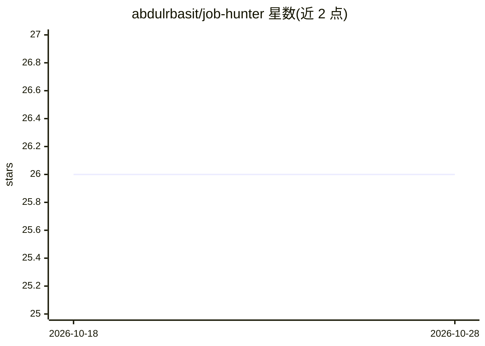

# abdulrbasit/job-hunter

⭐ 26 · Python · MIT · 推送 2026-10-20 · [GitHub](https://github.com/abdulrbasit/job-hunter) · 个人维护

**AI 自动化求职工具：抓取职位、评分匹配、定制简历与求职信**

面向求职者的 Python CLI + 桌面面板工具：抓取多个招聘网站、聚合器与公司招聘页的职位，按个人背景对每个职位评分匹配，逐岗定制简历并生成求职信（可导出 PDF），同时用面板与 analytics 跟踪投递状态。支持两种运行模式：agent 模式在 VS Code 内通过 Claude Code 或 Codex 技能处理评分与写作；llm-api 模式由 Python 内调用 LLM API 全自动跑完 抓取→评分→定制→求职信→PDF→跟踪 流水线。声明不会自动提交申请或联系任何人，只产出文件供人工审阅。

## 筛选速览

| 维度 | 判定 | 备注 |
|---|---|---|
| AI 角色 | `ai-native` | 本体是模型或模型工具 |
| 许可风险 | `permissive` | MIT |
| 部署形态 | `None` |  |
| 模型依赖 | locked-api |  |
| 硬件要求 | — | 无带数字的原话,不猜 |
| 安装摩擦 | `low` | 无编译、无系统依赖或容器化 |
| 成熟度 | — | 结构信号不足 |

## 能力要点

- 抓取多来源职位并按个人背景评分匹配
- 逐岗定制简历与求职信，输出可导出 PDF
- agent 模式（Claude Code/Codex 技能）与 llm-api 全自动模式双轨
- 原生桌面面板含 Candidates、Company Hunt、Insights、Analytics，公司招聘页用真实浏览器抓取

## 适用场景

- 批量抓取职位并按匹配度排序，决定优先投哪些
- 针对每个职位快速生成定制简历和求职信
- 在面板里跟踪所有投递状态避免遗漏
- 学生模式自动筛选实习/毕业项目/培训生岗位

## 场景标签

`网页抓取` `AI 写作` · 领域:效率与自动化

## 证据(README 行号)

> L5: Works interactively inside Claude Code or Codex (VS Code extensions), or runs fully autonomous via LLM API for unatt
> L49: |`agent`|Python prepares context; Claude Code or Codex (VS Code) skills handle scoring, tailoring, and writing|Inte
> L69: In `llm-api` mode, `job-hunter hunt` runs scrape → score → tailor → cover letter → PDF → tracker in one pipeline.

## 星数曲线

2026-10-18 26 → 2026-10-28 26（+0）

---
*卡片 v1 · prompt 1.4 · 生成 2026-10-26 · 置信度 high · 依据 README sha `ac7982b47b01` · [字段定义](../../DATASET.md)*
