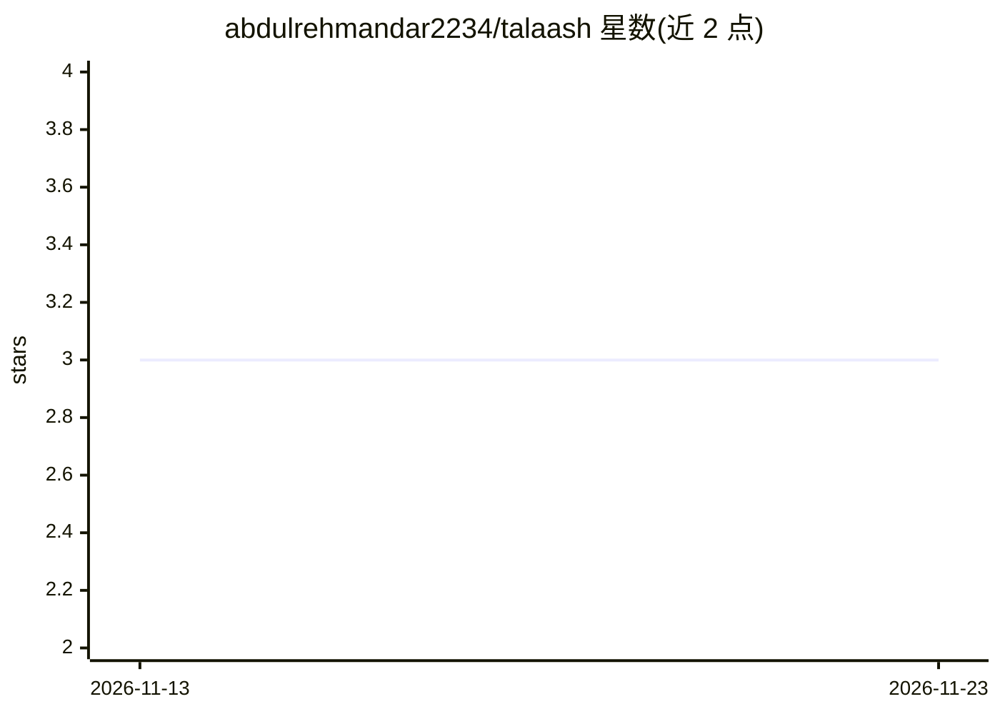

# abdulrehmandar2234/talaash

⭐ 3 · TypeScript · MIT · 推送 2026-11-14 · [GitHub](https://github.com/abdulrehmandar2234/talaash) · [官网](https://abdulrehmandar2234.github.io/talaash/) · 个人维护

**本地运行的求职助手：抓取、评分职位并生成真实 CV 与求职信**

在用户自己电脑上运行的求职助手，由 bot CLI 与 Next.js dashboard 组成，共享本地 PostgreSQL。每天定时从公司招聘板（Greenhouse/Lever/Workday 等）、职位板与 LinkedIn 游客搜索抓取职位，按国家/签证/远程地区过滤，先关键词评分再 AI 评审（0–100、理由、红旗）；据用户 master CV 生成 CV 版本、求职信与表单答案，并有第二遍 AI 校验不虚构技能。Chrome 扩展只填充空白表单，明确不代为提交申请。

## 筛选速览

| 维度 | 判定 | 备注 |
|---|---|---|
| AI 角色 | `ai-native` | 本体是模型或模型工具 |
| 许可风险 | `permissive` | MIT |
| 部署形态 | `self-host` | docker 或自建部署 |
| 模型依赖 | — | README 未给出锁定关系 |
| 硬件要求 | — | 无带数字的原话,不猜 |
| 安装摩擦 | `low` | 无编译、无系统依赖或容器化 |
| 成熟度 | — | 结构信号不足 |

## 能力要点

- 每日定时抓取 8 类公司招聘板与多个职位板，拒绝的职位保留原因
- AI 评审输出 0–100 评分、结论、缺口与红旗，并读取全文判断地点/签证限制
- CV 只重排与改写 master CV 内容，禁止新增技能（由测试强制）
- 本地优先：数据库与面板仅监听 127.0.0.1，个人文件 gitignore

## 适用场景

- 每天自动收集目标国家和可远程的软件职位
- 针对每个职位生成真实、可核对的 CV 版本与求职信
- 用 Chrome 扩展把准备好的答案填入申请表单
- 跟踪申请漏斗、回复率与跟进提醒

## 场景标签

`网页抓取` `AI 写作` `浏览器自动化` · 领域:效率与自动化

## 证据(README 行号)

> L10:  Talaash (Urdu for "search") is a personal job-search assistant that runs on your own computer.
> L38:  A keyword score against your CV, then an AI review (0–100, verdict, reasons, gaps, red flags) that also reads the 
> L111: |🏠 **Local first**|The database, the dashboard and the CLI run on your machine; the dashboard only answers on `127

## 星数曲线

2026-11-13 3 → 2026-11-23 3（+0）

---
*卡片 v1 · prompt 1.4 · 生成 2026-11-22 · 置信度 high · 依据 README sha `ac933e99ce91` · [字段定义](../../DATASET.md)*
