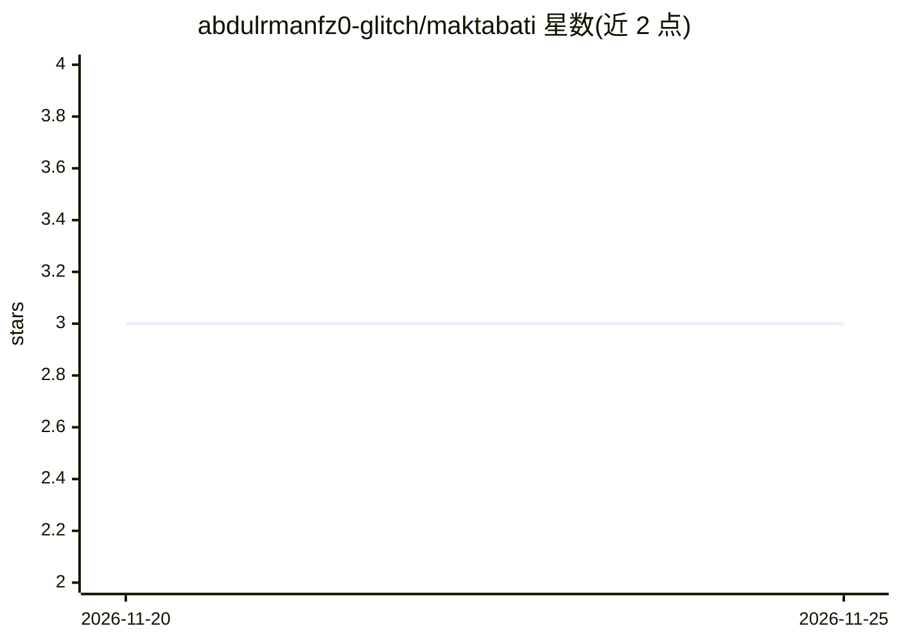

# abdulrmanfz0-glitch/maktabati

⭐ 3 · JavaScript · AGPL-3.0 · 推送 2026-11-21 · [GitHub](https://github.com/abdulrmanfz0-glitch/maktabati) · [官网](https://maktabati-61y.pages.dev) · 个人维护 · 中文 README

**面向阿拉伯语读者的 local-first 阅读应用，用自带 AI key 与藏书对话**

一个在浏览器中运行的阿拉伯语优先阅读环境：本地导入 PDF/EPUB/Markdown/纯文本，Web Worker 内解析且不上传服务器；提供四种阅读模板、RTL/字号/行距等排版控制，保存高亮、笔记、引用卡、书签、间隔复习卡，含画布思维导图与环境声。AI 功能通过用户自带 key 以浏览器 fetch 直连 OpenAI 兼容 Chat Completions 端点，与了解藏书的 AI 伴侣对话。数据存 IndexedDB，无后端服务器；扫描书 OCR 用 Tesseract 在本机运行。已知限制：不支持扫描版 PDF、无视觉模型、无 PWA/账号同步。

## 筛选速览

| 维度 | 判定 | 备注 |
|---|---|---|
| AI 角色 | `ai-enhanced` | 去掉 AI 部分产品仍成立 |
| 许可风险 | `viral` | AGPL-3.0 |
| 部署形态 | `library` | 以包/库形式分发 |
| 模型依赖 | local-ok | 支持本地模型 |
| 硬件要求 | — | 无带数字的原话,不猜 |
| 安装摩擦 | `low` | 无编译、无系统依赖或容器化 |
| 成熟度 | — | 结构信号不足 |

## 能力要点

- PDF/EPUB 在 Web Worker 本地解析，书籍与笔记存于 IndexedDB，无 Maktabati 服务器
- BYO key 直连 OpenAI 兼容端点，支持多连接保存与按任务钉选模型
- 四种阅读模板与阿拉伯语 RTL、变音符号等排版控制
- 高亮/笔记/引用卡/间隔复习卡与画布思维导图，Tesseract OCR 完全本机运行

## 适用场景

- 在浏览器里舒适地阅读阿拉伯语 PDF/EPUB 并做高亮批注
- 用自己的 API key 与 AI 讨论正在读的书籍章节
- 制作引用卡与间隔复习卡进行阅读复盘

## 场景标签

`知识库管理` `文档问答` · 领域:知识与检索

## 证据(README 行号)

> L5: An Arabic-first reading environment. Bring your own PDF, EPUB, Markdown, or
> L27: - Talks to an OpenAI-compatible Chat Completions provider with your own key.
> L29: Everything is local-first: books and study data live in IndexedDB on the

## 星数曲线

2026-11-20 3 → 2026-11-25 3（+0）

---
*卡片 v1 · prompt 1.4 · 生成 2026-11-22 · 置信度 high · 依据 README sha `8b4a6e7e18c7` · [字段定义](../../DATASET.md)*
