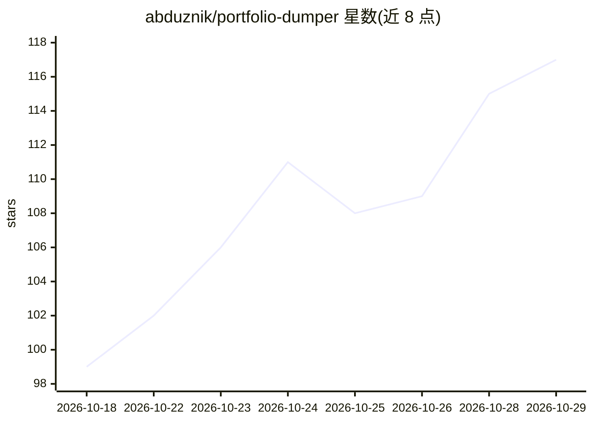

# abduznik/portfolio-dumper

⭐ 117 · HTML · MIT · 推送 2026-10-21 · [GitHub](https://github.com/abduznik/portfolio-dumper) · [官网](https://abduznik.github.io/portfolio-dumper/) · 个人维护

**将 GitHub 个人主页与仓库转换为 LLM 友好的 Markdown 的静态网页应用**

纯浏览器端运行的静态 Web 应用：读取 GitHub REST API，抓取用户 profile README、仓库列表或指定仓库的 README 与元数据，生成整洁的 Markdown，可复制或下载为文件。支持多类输入格式解析（用户名、@handle、URL、clone 链接）与组织页面。可选填 GitHub PAT 将速率限制从每小时 60 提升至 5,000，私有仓库暂不支持。自托管提供静态文件或 Docker 镜像两种方式。

## 筛选速览

| 维度 | 判定 | 备注 |
|---|---|---|
| AI 角色 | `ai-enhanced` | 去掉 AI 部分产品仍成立 |
| 许可风险 | `permissive` | MIT |
| 部署形态 | `self-host` | docker 或自建部署 |
| 模型依赖 | — | README 未给出锁定关系 |
| 硬件要求 | — | 无带数字的原话,不猜 |
| 安装摩擦 | `low` | 无编译、无系统依赖或容器化 |
| 成熟度 | — | 结构信号不足 |

## 能力要点

- 抓取 profile README、仓库列表或指定仓库并生成 Markdown
- 支持用户名/URL/SSH clone URL 等多种输入解析与组织页面
- 可选 GitHub PAT 提升 API 速率限制（60→5,000 次/小时）
- 纯浏览器静态运行，无服务端处理，令牌仅存于本地浏览器

## 适用场景

- 把 GitHub 主页或仓库内容整理成 Markdown 用于 AI 提示词
- 为自己的作品集快速生成文档素材
- 自托管部署在公司或个人服务器上做仓库内容导出

## 场景标签

`网页抓取` · 领域:效率与自动化

## 证据(README 行号)

> L11: Portfolio Dumper is a minimalist static web application designed to convert GitHub profiles and repositories into c
> L26: - Static and Secure: Runs entirely in the browser using the GitHub REST API.

## 星数曲线

2026-10-18 99 → 2026-10-29 117（+18）

---
*卡片 v1 · prompt 1.4 · 生成 2026-10-23 · 置信度 high · 依据 README sha `b65c13e8d3d4` · [字段定义](../../DATASET.md)*
