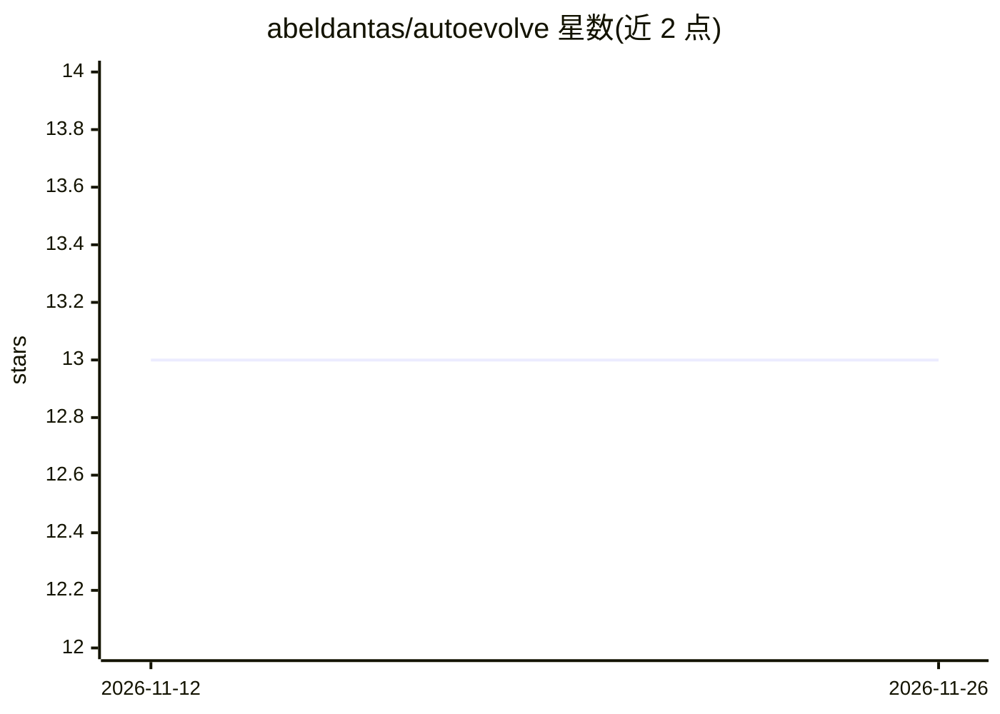

# abeldantas/autoevolve

⭐ 13 · Python · 推送 2026-05-27 · [GitHub](https://github.com/abeldantas/autoevolve) · 个人维护

**AI agent 行为文件自进化框架：按人类反馈变异并保留有效改动**

借鉴 autoresearch 的进化循环并应用于 agent 行为文件（AGENTS.md、SOUL.md 等）：分析 Discord 反应、纠正与任务结果等反馈信号，提出单个小型变异，经人工批准后通过 Git 提交生效，无效改动可回滚。面向运行在 OpenClaw + Discord + Claude Code + systemd 栈上的 agent；提供模板化的进化指令、可变/不可变文件配置、变异大小限制、漂移检测与不可变文件保护等安全机制。需 Linux VM、Python 3.10+ 与 Git。

## 筛选速览

| 维度 | 判定 | 备注 |
|---|---|---|
| AI 角色 | `ai-ecosystem` | LLM/agent 周边工具 |
| 许可风险 | `none` | — |
| 部署形态 | `None` |  |
| 模型依赖 | — | README 未给出锁定关系 |
| 硬件要求 | — | 无带数字的原话,不猜 |
| 安装摩擦 | `low` | 无编译、无系统依赖或容器化 |
| 成熟度 | — | 结构信号不足 |

## 能力要点

- 基于人类反馈信号的变异-评估-保留/回滚进化循环
- 不可变文件、保护段落、变异大小限制与漂移检测等安全护栏
- 每次变异为一次 commit，全程可审计可回滚
- 人工门控：变异仅被提议，批准后才应用

## 适用场景

- 让 Discord 上的 agent 根据用户反应迭代改进其人格与指令文件
- 为自修改 agent 配置安全阈值与不可变身份文件
- 按自己的节奏手动运行进化周期并审查每次改动

## 场景标签

`提示工程` · 领域:Agent 开发

## 证据(README 行号)

> L5: Your AI agents watch how humans react to them, propose mutations to their own behavior files, keep what works, and r
> L9: This framework is built for agents running on OpenClaw with Discord as the chat platform, Claude Code as the evoluti

## 星数曲线

2026-11-12 13 → 2026-11-26 13（+0）

---
*卡片 v1 · prompt 1.4 · 生成 2026-11-18 · 置信度 high · 依据 README sha `ccd237cb53b0` · [字段定义](../../DATASET.md)*
